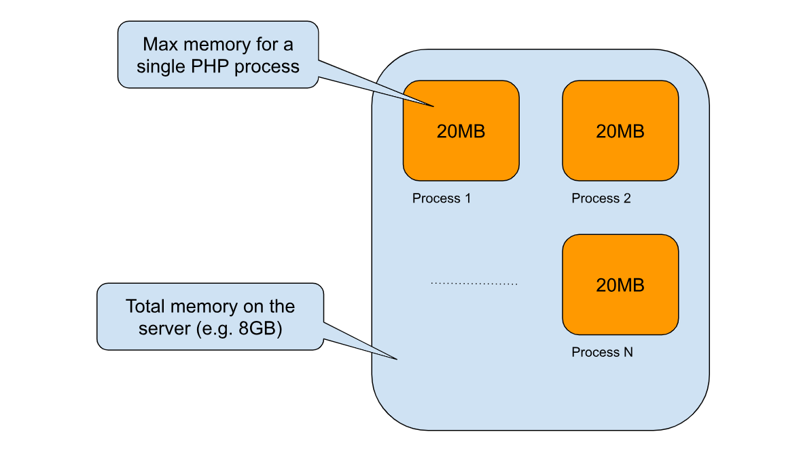

If you have already met the “Allowed memory size exhausted” error you know for sure that it is the hardest issue to debug. Unlike other PHP fatal errors, “Memory Size Exhausted” prevents all other application services from working, including those required in case of downtimes.

The error message in your server’s log will look like this:

```bash
PHP Fatal error: Allowed memory size of 1345667528 bytes exhausted (tried to allocate 1042898660 bytes) in {script-path-here} on line 370
```

So you have your application down, dozens of requests are failing, and your monitoring, or error reporting tools do not generate alerts. The only way you can find out about the problem is if a customer reports it to you.

Without additional memory available the functioning of the tools that should support your work is compromised because there is no space to execute additional tasks like send data to an external platform, as usual with other exceptions. And it is the reason why this error is the most slippery one you can encounter.

Sometimes I saw devs configuring an automatic email on certain exceptions. This might not work either, because there is no more memory available to execute the interaction with the email service.

To solve this problem permanently, you need to be aware how the “Memory Size Exhausted” error works in PHP, so I can show you a simple yet effective solution.

For more technical articles you can follow me on [**Linkedin**](https://www.linkedin.com/in/valeriobarbera/) or [**X**](https://x.com/Barbalerio).

## How Memory Limit works in PHP

In PHP the memory your application can use is limited by two thresholds:

- The memory a single PHP process is allowed to allocate (the most stringent)
- The total amount of memory available on your server



The max amount of memory a PHP process can allocate is defined by the “*memory_limit*” directive in the **php.ini** file. This helps prevent poorly written scripts for eating up all available memory on a server. To have no memory limit, set this directive to -1.

So when you stumble on the “Memory Size Exhausted” error is mostly because of the current request, or the script is trying to use more memory than it is allowed in the "memory_limit" directive.

## How much can I increase the memory_limit?

Consider that even if the application is not overcoming this threshold, if your server is getting a spike in traffic, the sum of the memory all the concurrent requests are trying to allocate may exhaust the total available memory on the server.

So you could have a bit of room to increase the default *memory_limit* declared in your **php.ini** file, but take care of the overall server stability.

Increasing the memory limit to 512MB for a single process it’s not a good idea. Just as an example. 256MB could be a good compromise.

## How to be notified in case of Memory Size Exhausted error

To find and fix the code responsible for needing more memory as soon as the error occurs, you have to allow the debugging service to work. Since the current process is exhausting its assigned memory, we could temporarily increase the “memory_limit” defined in the PHP configuration so we can have a bit more space to execute the last processes and allow reporting services to do their job.

Remember, the process is running out its 256MB of memory, but at the server level we should have free memory available.You can do that with the [**ini_set**](https://www.php.net/manual/en/function.ini-set.php) method:

```bash
ini_set('memory_limit', '260M');
```

With a simple additional statement you can dynamically add 5MB of memory on top of the current memory limit:

```bash
$currentMemoryLimit = (int) filter_var(ini_get('memory_limit'), FILTER_SANITIZE_NUMBER_INT);

ini_set('memory_limit', ($currentMemoryLimit + 5).'M');
```

5MB of memory is enough to allow your application to finalize its execution interacting with external services and unlock error reporting and notifications.

This is the solution I implemented into the Inspector package for Laravel:

[https://github.com/inspector-apm/inspector-laravel/blob/master/src/OutOfMemoryBootstrapper.php](https://github.com/inspector-apm/inspector-laravel/blob/master/src/OutOfMemoryBootstrapper.php)

So you are sure your monitoring system never stops also in case of memory errors.
