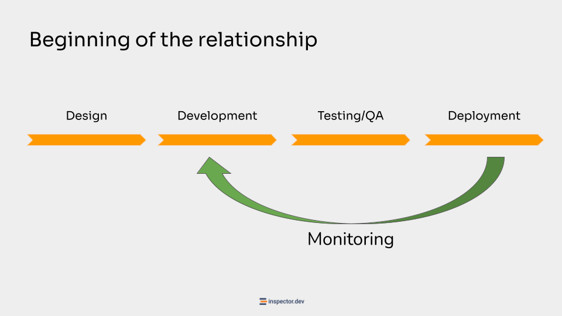

**View the full video: [https://www.youtube.com/watch?v=hqwakcz785M](https://www.youtube.com/watch?v=hqwakcz785M)**

Designing and marketing a monitoring platform allowed me to delve deeper into all the wrong things that developers do managing a software delivery cycle and the next steps of monitoring and control.

Too often developers associate monitoring with a few log lines scattered here and there throughout the code. But, when traffic volumes increase even slightly, chaos takes over.

Maybe everything doesn't necessarily have to crash, but tackling one of the structural phases of the software development cycle with these methods is the cause of a lot of frustrations both in the technical team but above all on the part of customers.

In principle I summarize a software delivery cycle into these four phases:

- **Design** is when you have to understand the domain of the project, collect requirements, what components the system will need, and all the preliminary tasks to put the project in the right track;
- **Development** - Then you have to build things. So the development and implementation of the actual software;
- **Testing** - In the sense of unit testing, or directly user testing - or more generally the Quality Assurance phase, perhaps with a staging environment, etc;
- **Deployment** - The process to put the application online, like CI/CD pipelines, and so on.

In each of these areas you are always looking for how to best optimize the process through tools and processes to perform certain tasks faster or with less chance of errors.

Let's think for example about the IDE - the editor we use to write the code - in Inspector we use JetBrains for example, which is a viable cost for improving and streamlining the software development phase.

And Deployment, with its specific tools, technologies, and so on.

At the end of this process there are two options.

## End of the project

After the final release the development project ends.

The customer just has to pay and we're done.

## Beginning of the relationship

The other scenario is when instead the release of the MVP is the first milestone to start the long term relation with the customer.

Now we have to support the customer in using the application and work on the maintenance and implementation of new features.

And then the last piece of the process is “Monitoring”.

Monitoring is the mechanism used to constantly connect the instance of the software deployed in production, with the development team that is in charge of it.

Closing this circle, and activating a continuous and sustainable iterative process you drastically improve the Developer Experience allowing your team to work more efficiently and ship higher quality updates faster.

At this point someone often emphasizes to me: “Of course, user feedback is always important”.

This is certainly true... but for technical departments this statement could be misunderstood. What users say is more important for a salesman. The technical department is more interested in what users actually do. For us, user feedback is mainly indirect, as we described in the previous lessons.

You don't give a damn what the customer thinks when they use your application.

The monitoring data is generated while the customer uses the application in his daily work. 90% of all maintenance work, upgrades, error detection and bug fix, must take place without the slightest contact with the customer. He only has to call us to develop new things, design new features, or even other projects.

On what has already gone online we must be completely autonomous and keep the customer out.

The fact that monitoring is the last phase to be addressed in this process means that you could arrive at that point already out of breath, with tight deadlines, with the first reports perhaps starting to emerge if the customer thinks things are not going well.

Being the last phase, it could be addressed in a slightly more sacrificial way.

## Software delivery becomes a Problem

The alternative, without this automated flow of information, is like developers work in the dark.

At a certain point, only problems will go back. Emergencies will arise practically continuously, as much as you keep your eyes on the logs you never make them in time to avoid negative impact for customers.

The result of a poor developer experience is customer complaints, and as we discussed in the previous lessons, the complexity of application development and maintenance grows rather than eases over time.

The trend of work is completely misaligned from customer expectations.

While those who pay expect things to be more stable and cheap over time, for you, as the software grows, the code base increases, external collaborations increase, etc., it becomes increasingly difficult to keep up with it and therefore more expensive.
