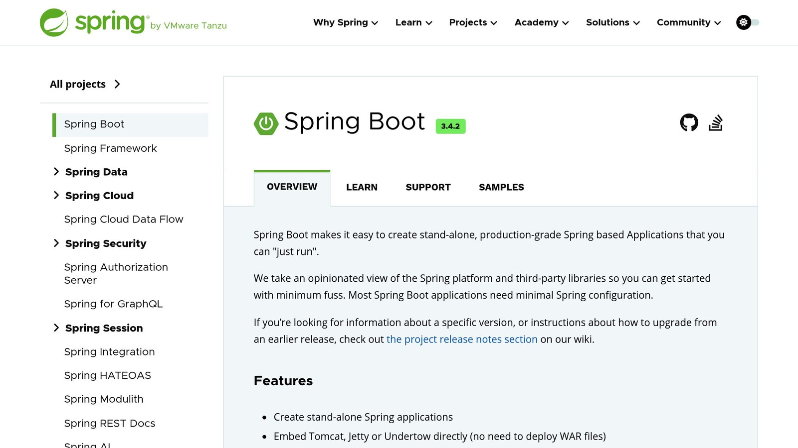

[**Spring Boot**](https://spring.io/projects/spring-boot) **HTTP filters** are essential for managing and modifying HTTP requests and responses in your applications. They act as a checkpoint between the web server and your application logic, enabling tasks like logging, authentication, and security enhancements.

## Key Points:

- **What are HTTP Filters?** Middleware components that intercept and process HTTP traffic before it reaches your controllers.
- **Benefits:**
  - Centralized handling of tasks like logging and security.
  - Modify headers, content, or parameters in requests and responses.
  - Sequential execution for complex workflows.
- **Common Use Cases:**
  - **Authentication:** Validate tokens or credentials (e.g., JWT filters).
  - **Logging:** Track request/response details for analytics.
  - **Compression:** Reduce payload size (e.g., GZIP filters).
  - **Security:** Add headers or prevent XSS attacks.

## Quick Example:

To create a filter, implement the `javax.servlet.Filter` interface:

```java
@Component
public class BasicFilter implements Filter {
    @Override
    public void doFilter(ServletRequest request, ServletResponse response, FilterChain chain) throws IOException, ServletException {
        // Pre-processing logic
        chain.doFilter(request, response); // Pass to next filter
        // Post-processing logic
    }
}
```

This article explains how to build, test, and optimize HTTP filters, offering practical examples and best practices for Spring Boot applications.

## Building Custom HTTP Filters

Creating custom HTTP filters in Spring Boot involves implementing the `javax.servlet.Filter` interface and understanding its key components. Below, we'll break down the process with clear steps and examples.

### Understanding the Filter Interface

The `javax.servlet.Filter` interface revolves around the `doFilter()` method. This method processes incoming requests and responses, passing them along the filter chain to the next filter or endpoint. Here's a simple example:

```java
@Component
public class BasicFilter implements Filter {
    @Override
    public void doFilter(ServletRequest request, ServletResponse response, 
                        FilterChain chain) throws IOException, ServletException {
        // Logic before passing the request further
        chain.doFilter(request, response);
        // Logic after processing the response
    }
}
```

Now that we've covered the basics, let's see how this works in a real-world scenario, like logging HTTP requests.

### Example: Logging HTTP Requests

Here's an implementation of a logging filter that captures and logs details about incoming requests and their processing time:

```java
@Slf4j
@Component
public class HttpLoggingFilter extends OncePerRequestFilter {
    @Override
    protected void doFilterInternal(HttpServletRequest request, 
                                  HttpServletResponse response, 
                                  FilterChain filterChain) throws ServletException, IOException {
        ContentCachingRequestWrapper requestWrapper = 
            new ContentCachingRequestWrapper(request);
        ContentCachingResponseWrapper responseWrapper = 
            new ContentCachingResponseWrapper(response);

        long startTime = System.currentTimeMillis();
        filterChain.doFilter(requestWrapper, responseWrapper);
        long timeTaken = System.currentTimeMillis() - startTime;

        String requestBody = new String(requestWrapper.getContentAsByteArray());
        log.info("Request URL: {} - Method: {} - Time: {}ms", 
                request.getRequestURL(), 
                request.getMethod(), 
                timeTaken);

        responseWrapper.copyBodyToResponse();
    }
}
```

This filter uses `ContentCachingRequestWrapper` and `ContentCachingResponseWrapper` to cache request and response bodies for logging purposes. It also calculates the time taken to process the request.

### How to Test Your Custom Filter

Testing a custom filter ensures it behaves as expected. This typically involves using mocks to simulate requests and responses, and assertions to validate outcomes. Here's a basic test case for the logging filter:

```java
@SpringBootTest
class HttpLoggingFilterTest {
    @Autowired
    private HttpLoggingFilter filter;

    @Test
    void testFilterLogging() throws Exception {
        MockHttpServletRequest request = 
            new MockHttpServletRequest("POST", "/api/test");
        MockHttpServletResponse response = new MockHttpServletResponse();
        FilterChain filterChain = mock(FilterChain.class);

        request.setContent("test content".getBytes());
        filter.doFilter(request, response, filterChain);

        verify(filterChain, times(1)).doFilter(any(ServletRequest.class), 
            any(ServletResponse.class));
    }
}
```

This test checks that the filter processes the request and passes it along the chain. It uses `MockHttpServletRequest` and `MockHttpServletResponse` to simulate the HTTP environment and `verify()` to ensure the filter chain is called correctly.

## Filter Setup in [Spring Boot](https://spring.io/projects/spring-boot)



Spring Boot provides several ways to configure HTTP filters, giving you control over how requests and responses are processed.

### Using @Component

The `@Component` annotation is the easiest way to register a filter. It automatically applies the filter to all requests without any extra configuration:

```java
@Component
public class SimpleLoggingFilter implements Filter {
    @Override
    public void doFilter(ServletRequest request, ServletResponse response, 
                        FilterChain chain) throws IOException, ServletException {
        HttpServletRequest httpRequest = (HttpServletRequest) request;
        log.info("Processing request: {} {}", 
                 httpRequest.getMethod(), 
                 httpRequest.getRequestURI());
        chain.doFilter(request, response);
    }
}
```

### Using FilterRegistrationBean

To customize filter behavior, such as targeting specific URL patterns or setting execution order, use `FilterRegistrationBean`:

```java
@Configuration
public class FilterConfig {
    @Bean
    public FilterRegistrationBean<RequestLoggingFilter> loggingFilter() {
        FilterRegistrationBean<RequestLoggingFilter> registrationBean = 
            new FilterRegistrationBean<>();

        registrationBean.setFilter(new RequestLoggingFilter());
        registrationBean.addUrlPatterns("/api/*");
        registrationBean.setName("requestLoggingFilter");
        registrationBean.setOrder(1);

        return registrationBean;
    }
}
```

### Managing Filter Order

To specify the order of multiple filters, use `FilterRegistrationBean` with `setOrder()` or the `@Order` annotation. Filters with lower order values run first, which is especially useful for security-related filters:

```java
@Component
@Order(1)
public class SecurityFilter implements Filter {
    // Filter implementation
}

@Component
@Order(2)
public class LoggingFilter implements Filter {
    // Filter implementation
}
```

The `@Component` approach works well for straightforward, global filters like logging. On the other hand, `FilterRegistrationBean` gives you more control, making it suitable for filters that need to handle specific tasks like security or request validation. Both methods can be combined with advanced options like URL pattern matching and error handling to fine-tune filter behavior.

## Advanced Filter Techniques

Once you've set up basic filters, you can use advanced techniques to gain more control over how HTTP requests and responses are managed.

### URL Pattern Filtering

The `@WebFilter` annotation lets you apply filters to specific URL patterns. For example, you can target API endpoints or admin routes like this:

```java
@WebFilter(urlPatterns = {"/api/v1/*", "/admin/*"}, 
          filterName = "advancedLoggingFilter")
public class AdvancedLoggingFilter implements Filter {
    private final Logger log = LoggerFactory.getLogger(AdvancedLoggingFilter.class);

    @Override
    public void doFilter(ServletRequest request, ServletResponse response, 
                        FilterChain chain) throws IOException, ServletException {
        HttpServletRequest httpRequest = (HttpServletRequest) request;
        log.info("Processing {} request to {}", 
                 httpRequest.getMethod(), 
                 httpRequest.getRequestURI());

        chain.doFilter(request, response);
    }
}
```

This approach ensures that only specified endpoints are processed by the filter, making it easier to manage traffic and logs.

### Modifying Requests and Responses

Filters can also tweak requests and responses, such as adding headers or altering content. Here's an example that adds security headers and wraps the response for further modifications:

```java
public class SecurityHeadersFilter implements Filter {
    @Override
    public void doFilter(ServletRequest request, ServletResponse response, 
                        FilterChain chain) throws IOException, ServletException {
        HttpServletResponse httpResponse = (HttpServletResponse) response;

        // Add security headers
        httpResponse.setHeader("X-XSS-Protection", "1; mode=block");
        httpResponse.setHeader("X-Frame-Options", "DENY");
        httpResponse.setHeader("X-Content-Type-Options", "nosniff");

        // Wrap response for content modification
        ContentCachingResponseWrapper responseWrapper = 
            new ContentCachingResponseWrapper((HttpServletResponse) response);

        chain.doFilter(request, responseWrapper);

        // Modify response content if needed
        byte[] responseContent = responseWrapper.getContentAsByteArray();
        responseWrapper.copyBodyToResponse();
    }
}
```

This filter adds security headers to every response and allows for response content adjustments if required.

### Handling Errors in Filters

Filters can also catch and handle errors during request processing. Here's an example of managing exceptions within a filter:

```java
public class ErrorHandlingFilter implements Filter {
    private static final Logger log = 
        LoggerFactory.getLogger(ErrorHandlingFilter.class);

    @Override
    public void doFilter(ServletRequest request, ServletResponse response, 
                        FilterChain chain) throws IOException, ServletException {
        HttpServletResponse httpResponse = (HttpServletResponse) response;

        try {
            chain.doFilter(request, response);
        } catch (RuntimeException e) {
            log.error("Filter chain execution failed", e);

            if (!response.isCommitted()) {
                httpResponse.setStatus(HttpServletResponse.SC_INTERNAL_SERVER_ERROR);
                httpResponse.getWriter().write(
                    "An unexpected error occurred processing your request");
            }
        }
    }
}
```

This example ensures that any runtime exceptions are logged and handled gracefully, preventing incomplete or broken responses.

The `FormContentFilter` in Spring is another great example of advanced filter usage. It supports form data for HTTP methods like PUT, PATCH, and DELETE.

> "Filters are a powerful tool for web applications, allowing for the interception and modification of HTTP requests and responses." - Spring Framework Documentation

## Filter Guidelines and Speed

Once you've set up and configured filters, it's important to think about how they impact performance and how to use them effectively.

### Filters vs Interceptors

Filters and interceptors are both tools in Spring Boot, but they work at different levels and are designed for different tasks.

| Feature | HTTP Filters | Spring Interceptors |
| --- | --- | --- |
| **Execution Level** | Web Server | Spring MVC |
| **Request Access** | Raw HTTP requests | Handler-mapped requests |
| **Performance Impact** | Lower overhead | Higher overhead |
| **Use Cases** | Authentication, logging, compression | Method-level operations, request validation |
| **URL Pattern Support** | Native support | Requires configuration |

Knowing these distinctions can help you choose the right approach to improve your application's performance.

### Speed Improvements

Want to make your filters run faster? Here are a few tips:

- Focus on **selective URL pattern matching** to reduce unnecessary processing.
- Use Spring's `ShallowEtagHeaderFilter` to enable response caching.
- Avoid performing database operations directly inside filters.

> "Filters generally have less overhead than interceptors because they operate at the servlet container level and do not require the Spring MVC framework to be invoked. However, the performance difference is typically minimal unless dealing with very high traffic volumes."

### Common Filter Mistakes

Optimizing filters is critical, but it's just as important to avoid common pitfalls that can hurt performance.

**Thread Safety and Ordering**

Here's an example of what NOT to do:

```java
@Component
public class ThreadSafetyExample implements Filter {
    private String lastRequest; // This is not thread-safe!

    @Override
    public void doFilter(ServletRequest request, ServletResponse response, 
                        FilterChain chain) {
        lastRequest = ((HttpServletRequest) request).getRequestURI();
        chain.doFilter(request, response);
    }
}
```

And here's an example of how to handle filter ordering properly:

```java
@Component
@Order(Ordered.HIGHEST_PRECEDENCE)
public class SecurityFilter implements Filter {
    // Filters with higher precedence execute first
}
```

To keep performance on track:

- Make sure your filters handle **one responsibility** at a time.
- Write thread-safe code to avoid concurrency issues.
- Handle exceptions gracefully to prevent unexpected failures.
- Arrange filters in the correct order, based on dependencies.
- Apply filtering only to the URLs that need it.
- Take advantage of Spring's built-in caching features.

Sloppy filter implementations can lead to performance issues. Use tools like [**Spring Boot Actuator**](https://docs.spring.io/spring-boot/reference/actuator/index.html) or [**JMeter**](https://jmeter.apache.org/) to measure the impact of your filters before rolling them out to production.

## Summary

### Filter Basics Review

In Spring Boot, HTTP filters serve as low-level tools for modifying, validating, or logging HTTP traffic. Operating below the Spring MVC interceptors, they are particularly suited for tasks like authentication and logging.

### Filter Uses and Examples

Filters are incredibly useful in various scenarios. For example, you cab use filters for tasks such as request rate limiting and authentication.

Here are some common types of filters and their purposes:

| Filter Type | Primary Use |
| --- | --- |
| Authentication | Token validation, user checks |
| Logging | Tracking requests and responses |
| Compression | Reducing response size |
| CORS | Managing cross-origin requests |
| Caching | Storing responses for reuse |

With these examples in mind, let's look at how to set up and fine-tune HTTP filters.

### Getting Started Guide

To implement a filter, start by using the `Filter` interface and annotate it with `@Component` for basic cases. You can control the execution order with `@Order` or `FilterRegistrationBean`. For performance monitoring, tools like Spring Boot Actuator can help identify potential bottlenecks.

> "Filters generally have less overhead than interceptors because they operate at the servlet container level and do not require the Spring MVC framework to be invoked. However, the performance difference is typically minimal unless dealing with very high traffic volumes."

## Related Blog Posts

- [How to Monitor SQL Performance in Spring Boot](/how-to-monitor-sql-performance-in-spring-boot/)
- [5 Ways to Optimize Symfony Application Performance](/5-ways-to-optimize-symfony-application-performance/)
- [Spring Boot Error Handling: A Step-by-Step Guide](/spring-boot-error-handling-a-step-by-step-guide/)
- [How to cache Spring Boot request body to read the request content multiple time](/how-to-cache-spring-boot-request-body-to-read-the-request-content-multiple-time/)
