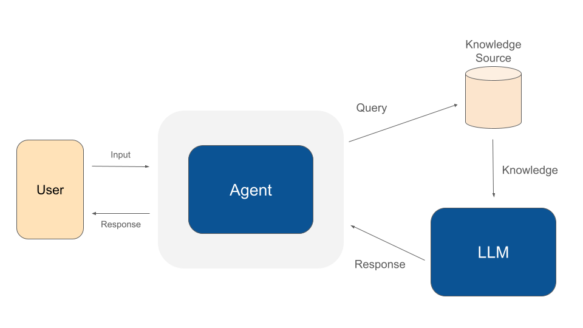
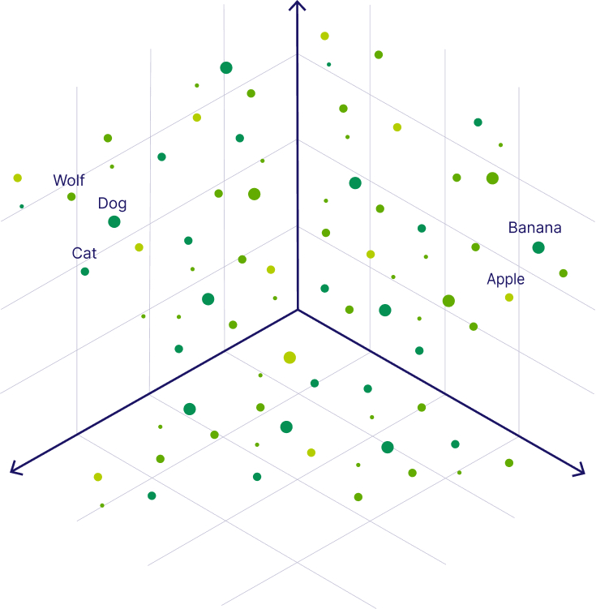
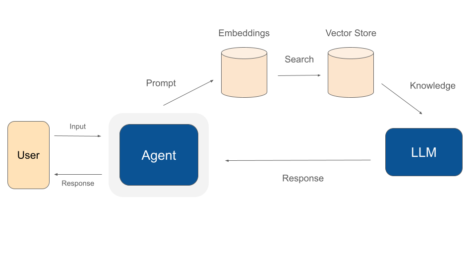
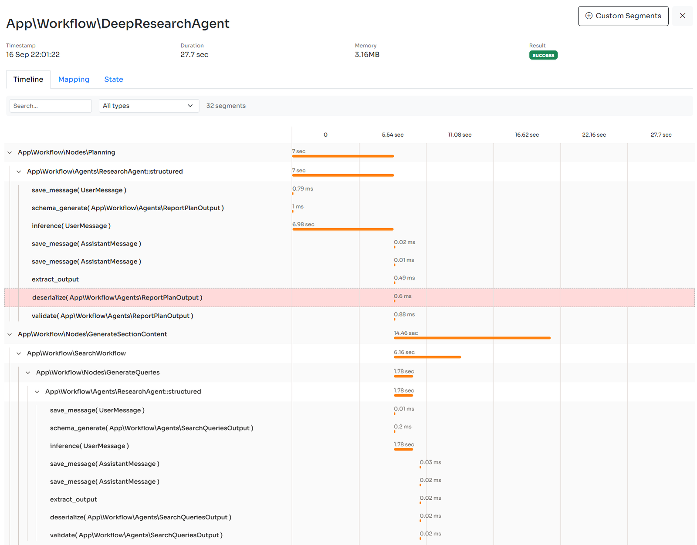

Implementing Retrieval-Augmented Generation (RAG) is often the first "wall" PHP developers hit when moving beyond simple chat scripts. While the concept of "*giving an LLM access to your own data*" is straightforward, the tasks required to make it work reliably in a PHP environment can be frustrating. You have to manage document parsing, vector embeddings, storage in a vector database, and the final prompt orchestration. Most developers end up trying to glue several disparate libraries together, only to find that the resulting system is brittle and hard to maintain.

Neuron was designed to eliminate this friction. It provides a built-in RAG module that handles the heavy lifting of the data pipeline, allowing you to focus on the logic of your agent rather than the mechanics of vectors management and similarity search. In a typical scenario, like building a support agent that needs to "read" your company’s internal documentation, you don't want to manually handle the chunking of text or the API calls to OpenAI's embedding models. Neuron abstracts these into a fluent workflow where you define a "Data Source," and the framework ensures the most relevant snippets of information are injected into the agent's context window at runtime.

## Understanding the Foundation: What RAG Really Means

Retrieval Augmented Generation breaks down into three critical components that work in harmony to solve a fundamental problem in AI: how do we give language models access to specific, up-to-date, or proprietary information that wasn’t part of their original training data?

The “G” part of the *RAG* acronym is straightforward—we’re talking about “Generative” AI models like GPT, Claude, Gemini, or any large language model that can produce human-like text responses. These models are incredibly powerful, but they have a significant limitation: they only know what they were trained on, and that knowledge has a cutoff date. They can’t access your company’s internal documents, your personal notes, or real-time information from your databases.

This is where the “Retrieval Augmented” component becomes transformative. Instead of relying solely on the model’s pre-trained knowledge, we augment its capabilities by retrieving relevant information from external sources at the moment of generation. Think of it as giving your AI agent a research assistant that can instantly find and present relevant context before answering any question.

Below you can see an example of how this process should work:



## The Magic Behind Embeddings and Vector Spaces

To understand how retrieval works in practice, we need to dive into embeddings—a concept that initially seems abstract but becomes intuitive once you see it in action. An embedding is essentially a mathematical representation of text, images, or any data converted into a list of numbers called a vector. What makes this powerful is that similar concepts end up with similar vectors, creating a mathematical space where related ideas cluster together.



When I first started working with Neuron AI, I was amazed by how this actually works in practice. Imagine you have thousands of documents—customer support tickets, product manuals, internal wikis, research papers. Traditional keyword search would require exact matches or clever Boolean logic to find relevant information. But with embeddings, you can ask a question like “How do I troubleshoot connection issues?” and the system will find documents about network problems, authentication failures, and server timeouts, even if those documents never use the exact phrase “connection issues”.

The process works by converting both your question and all your documents into these mathematical vectors. The system then calculates which document vectors are closest to your question vector in this multi-dimensional space. It’s like having a librarian who understands the meaning and context of your request, not just the literal words you used.

You can go deeper into this technology in the article below.

[Vector Store & AI Agents - Beyond The Traditional Data Storage](/vector-store-ai-agents-beyond-the-traditional-data-storage/)

## The Challenge of real RAG Implementations

The conceptual understanding of RAG is one thing, actually building a working system is another challenge entirely. This is where the complexity really emerges, and it’s why Neuron is such a valuable tool for PHP developers entering this space.

The ecosystem involves multiple moving parts: you need to chunk your documents effectively, generate embeddings using appropriate models, store and index those embeddings in a vector database, implement semantic search functionality, and then orchestrate the retrieval and generation process seamlessly.



Each of these steps involves technical decisions that can significantly impact your agent’s performance (speed, and quality of responses). How do you split long documents into meaningful chunks? Which embedding model works best for your domain? **How do you handle updates to your knowledge base?** How do you balance retrieval accuracy with response speed? These questions become more pressing when you’re building production systems that need to scale and perform reliably.

In the detailed implementation guide that follows, we’ll explore how Neuron simplifies this complex orchestration, providing PHP developers with tools and patterns that make RAG agent development both accessible and powerful.

## Install Neuron AI

To get started, you can install the core framework and the RAG components via Composer:

```php
composer require neuron-core/neuron-ai
```

## Create a RAG Agent

To create a RAG, Neuron provides you with a dedicated class you can extend to orchestrate the necessary components like the AI provider, vector store and the embeddings provider.

First, let's create the RAG class:

```bash
php vendor/bin/neuron make:rag App\\Neuron\\MyRAG
```

Here is an example of a RAG implementation:

```php
namespace App\Neuron;

use NeuronAI\Providers\AIProviderInterface;
use NeuronAI\Providers\Anthropic\Anthropic;
use NeuronAI\RAG\Embeddings\EmbeddingsProviderInterface;
use NeuronAI\RAG\Embeddings\OpenAIEmbeddingsProvider;
use NeuronAI\RAG\RAG;
use NeuronAI\RAG\VectorStore\FileVectorStore;
use NeuronAI\RAG\VectorStore\VectorStoreInterface;

class MyRAG extends RAG
{
    protected function provider(): AIProviderInterface
    {
        return new Anthropic(
            key: 'ANTHROPIC_API_KEY',
            model: 'ANTHROPIC_MODEL',
        );
    }
    
    protected function embeddings(): EmbeddingsProviderInterface
    {
        return new VoyageEmbeddingsProvider(
            key: 'VOYAGE_API_KEY',
            model: 'VOYAGE_MODEL'
        );
    }
    
    protected function vectorStore(): VectorStoreInterface
    {
        return new FileVectorStore(
            directory: __DIR__,
            name: 'demo'
        );
    }
}
```

In the example above we provided the RAG with a connection to:

- The LLM (Anthropic in this case)
- The Embedding provider - The service able to transform text into vector embeddings
- The vector store to persist the generated embeddings and perform document retrieval

Be sure to provide the appropriate infomration to connect with these services. You have plenty of options for each of these components. You can use local systems or managed services, so feel free to explore the documentation to choose your preferred ones: [https://docs.neuron-ai.dev/components/ai-provider](https://docs.neuron-ai.dev/components/ai-provider)

## Feed Your RAG With A Knowledge Base

At this stage the vector store behind our RAG agent is empty. If we send a prompt to the agent it will be able to respond leveraging only the underlying LLM training data.

```php
use NeuronAI\Chat\Messages\UserMessage;

$response = MyRAG::make()
    ->chat(
        new UserMessage('What size is the door handle on our top car model?')
    );
    
echo $response->getContent();

// I don't really know specifically about your top car model. Do you want to provide me with additional information?
```

We need to feed the RAG with some knowledge to make it able to respond to questions about private information outside its default training data.

## Neuron AI Data Loader

To build a structured AI application you need the ability to convert all the information you have into text, so you can generate embeddings, save them into a vector store, and then feed your Agent to answer the user’s questions.


Neuron has a dedicated module to simplify this process. In order to answer the previous question (*What size is the door handle on our top car model?*) we can feed the rag with documents (Markdown files, PDFs, HTML pages, etc) containing such information.

You can do it in a just a few lines of code:

```php
use NeuronAI\RAG\DataLoader\FileDataLoader;

// Use the file data loader component to process documents
$documents = FileDataLoader::for(__DIR__)
        ->addReader('pdf', new \NeuronAI\RAG\DataLoader\PdfReader())
        ->addReader(['html', 'xhtml'], new \NeuronAI\RAG\DataLoader\HtmlReader())
        ->getDocuments();

MyRAG::make()->addDocuments($documents);
```

As you can see from the example above you can just point the data loader to a directory containing all the files you want to load into the vector store, and it automatically does:

- Extract all text inside files
- Chunk the content with a splitting strategy
- Pass all the documents into the RAG to generate ambeddings and finally persist all this information into the vector store.

It's just an example to demonstrate how you can create a complete data pipeline for your agentic application in 5 lines of code. You can learn more about the extensibility and customization opportunities for readers and splitters in the documentation: [https://docs.neuron-ai.dev/rag/data-loader](https://docs.neuron-ai.dev/rag/data-loader)

## Talk to the chat bot

Imagine having previously populated the vector store with the knowledge base you want to connect to the RAG agent, and now you want to ask questions.

To start the execution of a RAG you call the `chat()` method:

```php
use App\Neuron\MyRAG;
use NeuronAI\Chat\Messages\UserMessage;

$response = MyRAG::make()->chat(
    new UserMessage('What size is the door handle on our top car model?')
);
    
echo $response->getContent();

// Based on 2025 sales results, the top car model in your catalog is XXX...
```

## Monitoring & Debugging

Many of the Agents you build with NeuronAI will contain multiple steps with multiple invocations of LLM calls, tool usage, access to external memories, etc. As these applications get more and more complex, it becomes crucial to be able to inspect what exactly your agent is doing and why. Share feedback on the editor

Why is the model taking certain decisions? What data is the model reacting to?

The [Inspector](/) team designed Neuron AI with built-in observability features, so you can monitor AI agents were running, helping you maintain production-grade implementations with confidence.

To start monitoring your agentic systems you need to add the `INSPECTOR_INGESTION_KEY` variable in your application environment file. Authenticate on [app.inspector.dev](https://app.inspector.dev/register)  
to create a new one.

```bash
INSPECTOR_INGESTION_KEY=nwse877auxxxxxxxxxxxxxxxxxxxxxxxxxxxx
```

When your agents are being executed, you will see the details of their internal steps on the Inspector dashboard.



## Resources

If you are getting started with AI Agents, or you simply want to elevate your skills to a new level here is a list of resources to help you go in the right direction:

- **Repository**: [https://github.com/inspector-apm/neuron-ai](https://github.com/inspector-apm/neuron-ai)
- **Newsletter**: [https://neuron-ai.dev](https://neuron-ai.dev/)
- **E-Book (Start With AI Agents In PHP)**: [https://www.amazon.com/dp/B0F1YX8KJB](https://www.amazon.com/dp/B0F1YX8KJB)

## Moving Forward

The complexity of orchestrating embeddings, vector databases, and language models might seem a bit daunting, but remember that every expert was once a beginner wrestling with these same concepts.

The next step is to dive into the practical implementation. Neuron AI framework is designed specifically to bridge the gap between RAG theory and production-ready agents, handling the complex integrations while giving you the flexibility to customize the behavior for your specific use case. Start building your first RAG agent today and discover how powerful context-aware AI can transform your applications.
