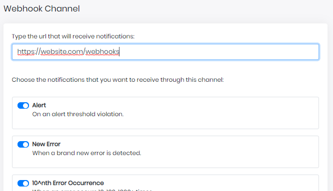
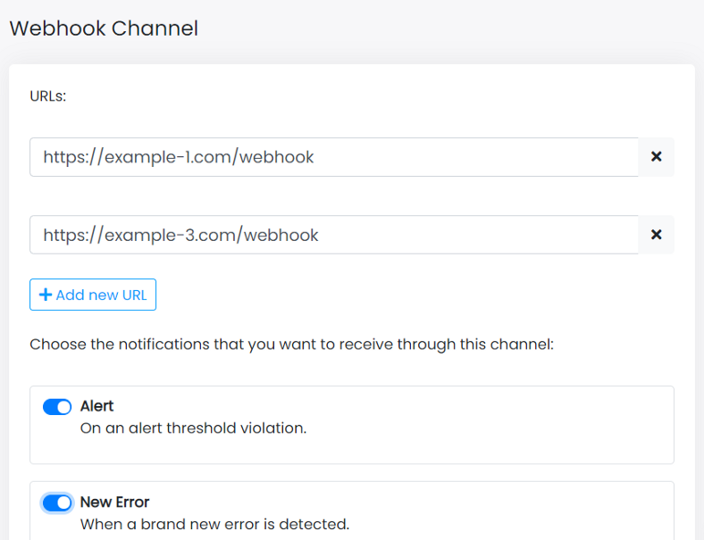

Hi, I’m Valerio CTO at Inspector.

As integration becomes increasingly central to the way that our customers automate their internal process, we have recently released a new feature for our Webhook Notification Channel.

## Before

Before this product upgrade you could configure the URL of the external system to which you wanted to send the notifications.

The URL will receive notification in form of an http POST request with a specific headers and body based on the type of event detected.

## What you can do now

Now you can assign multiple URLs to the same Webhook Channel, as shown in the image below:

Inspector will send the same http POST request to all external URLs attached to the channel.
