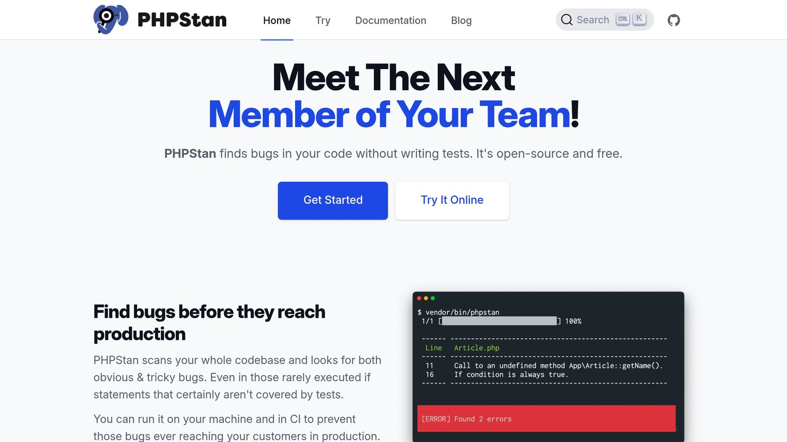
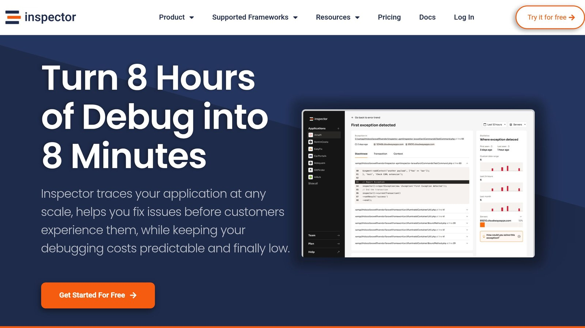

**Want to write better, bug-free PHP code in** [**Symfony**](https://symfony.com/)**?** Start using `declare(strict_types=1)` at the top of your files. This enforces strict type checking, preventing PHP from automatically converting data types and catching type-related errors early.

## Why use `strict_types` in Symfony?

- **Avoid Bugs**: Eliminates automatic type conversions that can lead to unexpected behavior.
- **Clearer Code**: Makes function inputs and outputs explicit, improving readability.
- **Better Tools**: Enhances IDE support, static analysis, and debugging.

## How to implement it:

1. Add `declare(strict_types=1);` at the very beginning of every PHP file.
2. Use strict type hints (`int`, `string`, `?array`, etc.) for function parameters and return values.
3. Apply tools like [PHPStan](https://phpstan.org/) to automate type checking in your CI/CD pipeline.

Strict typing improves Symfony projects by making them more predictable, easier to debug, and simpler to maintain. Whether you're starting fresh or updating an old project, this small change can have a big impact on code quality.

## Implementing strict types in Symfony

### Placement of strict_types declaration

To use the `declare(strict_types=1)` directive effectively, place it at the very start of each PHP file - before any code or even whitespace. Here's an example of how it looks in a Symfony controller:

```php
<?php declare(strict_types=1);

namespace App\Controller;

use Symfony\Component\HttpFoundation\Response;
use Symfony\Component\Routing\Annotation\Route;

class ProductController
{
    public function show(int $id): Response
    {
        return new Response("Product ID: {$id}");
    }
}
```

For consistency, include `declare(strict_types=1)` in all files across your Symfony project.

### Symfony coding standards for strict types

Symfony encourages consistent use of type declarations throughout your application. Below is an example of strict typing within a Symfony service class that uses dependency injection:

```php
<?php declare(strict_types=1);

namespace App\Service;

class ProductService
{
    public function calculatePrice(float $basePrice, int $quantity): float
    {
        return $basePrice * $quantity;
    }

    public function getProductDetails(int $id): ?array
    {
        // Return product details or null if not found
    }
}
```

Strict typing also plays an important role in managing entities and injecting dependencies. Consider this example:

```php
<?php declare(strict_types=1);

namespace App\Service;

use App\Entity\Product;
use Doctrine\ORM\EntityManagerInterface;

class ProductManager
{
    public function __construct(
        private EntityManagerInterface $entityManager
    ) {}

    public function createProduct(string $name, float $price): Product
    {
        $product = new Product();
        $product->setName($name);
        $product->setPrice($price);

        $this->entityManager->persist($product);
        $this->entityManager->flush();

        return $product;
    }
}
```

Key practices for strict typing in Symfony include:

- Using nullable types (e.g., `?string`, `?int`) and union types (e.g., `string|int`, available in PHP 8+) to handle flexible data scenarios.
- Declaring return types for all methods.
- Specifying parameter types, especially for constructor injection.

These approaches not only align with Symfony's guidelines but also make your code easier to maintain and less prone to errors. Strict typing brings clarity to your code, enhancing both reliability and readability.

## Impact on Symfony applications

### Error prevention and debugging

Strict typing helps catch type-related errors in Symfony applications early. Take this example of a Symfony service:

```php
<?php declare(strict_types=1);

namespace App\Service;

class OrderCalculator
{
    public function calculateTotal(float $amount, int $quantity): float
    {
        return $amount * $quantity;
    }
}
```

If you pass a string instead of a float to the `calculateTotal` method, a `TypeError` will occur. This ensures that such issues are identified during development rather than causing problems in production. This early detection saves debugging time and keeps the code reliable.

### Developer tools and efficiency

Strict typing improves development tools by enabling more accurate code completion, safer refactoring, better static analysis, and clearer auto-generated documentation. For Symfony applications, this means a smoother development process with fewer surprises.

Tools like PHPStan work more effectively with strictly typed code, offering deeper analysis for Symfony projects. This approach helps developers spot potential issues early, leading to higher-quality code.

Here’s how strict typing benefits Symfony teams:

- **Lower Technical Debt**: Clear type definitions prevent hidden type-related problems.
- **Better Code Reviews**: Explicit types make the purpose of the code easier to understand.
- **Simpler Maintenance**: Type declarations act as built-in documentation, making the code easier to manage.

To get the most out of strict typing, it’s important to apply it consistently across the entire Symfony codebase. However, it’s worth noting that challenges can arise, especially when dealing with older codebases or third-party libraries.

## Common strict typing issues

Strict typing improves code reliability, but using it alongside non-strict external libraries can lead to some tricky situations.

### Working with external libraries

One major issue comes up when third-party libraries return mixed types or don't follow strict typing rules. A practical way to handle this is by using the wrapper pattern. Here's an example:

```php
<?php declare(strict_types=1);

namespace App\Wrapper;

use ThirdParty\ExternalLibrary;

class ExternalLibraryWrapper
{
    private ExternalLibrary $library;

    public function __construct(ExternalLibrary $library)
    {
        $this->library = $library;
    }

    public function getProcessedData(): array
    {
        $result = $this->library->getData(); // Returns mixed
        return is_array($result) ? $result : [];
    }
}
```

This wrapper ensures that the output from the external library is validated and safely cast to the expected type. But dealing with external libraries isn't the only hurdle; transitioning older codebases to strict typing comes with its own difficulties.

### Converting existing projects

When updating an existing project to use strict typing, a step-by-step approach works best:

- **Start with new code**: Apply strict types to all new files to avoid adding more technical debt.
- **Focus on critical areas**: Begin by adding strict typing to key business logic or frequently used code.
- **Use automated tools**: Integrate tools like PHPStan into your CI/CD pipeline to catch type-related issues early.

This method helps maintain clean and reliable code during the transition. Use monitoring tools like [Inspector.dev](/symfony/) to spot potential problems before they affect production.

Here's an example of how you can update an existing method:

```php
// Before
function calculateDiscount($price, $percentage);
// After
function calculateDiscount(float $price, float $percentage): float
```

Changes like this can ripple through your codebase, so thorough testing is essential to ensure nothing breaks.

## Tools for Strict Type Management

Managing strict types in Symfony projects calls for the right tools to ensure your codebase remains reliable and error-free. Here's how to use some essential tools to keep type safety in check.

### Using [PHPStan](https://phpstan.org/) for Type Checking



PHPStan is a static analysis tool that helps catch type-related issues early in the development process. To get started, add PHPStan to your Symfony project using Composer:

```bash
composer require --dev phpstan/phpstan
```

Next, configure PHPStan in a `phpstan.neon` file. Set it to the highest strictness level to uncover potential issues like undefined methods, incorrect type hints, or mismatched types. PHPStan's deep integration with Symfony's service container ensures it analyzes your code with Symfony's architecture in mind.

### Automating Type Checking with CI/CD

After setting up PHPStan, you can integrate it into your CI/CD pipelines to enforce type safety automatically. A GitHub Actions workflow is a great way to do this:

```yaml
name: Type Check
on: [push, pull_request]
jobs:
  phpstan:
    runs-on: ubuntu-latest
    steps:
      - uses: actions/checkout@v2
      - name: PHPStan
        run: |
          composer install
          vendor/bin/phpstan analyse src tests
```

This configuration ensures type checks are performed with every code push or pull request, helping your team maintain consistent standards.

### Monitoring with Inspector.dev



While CI/CD workflows handle issues during development, production environments need monitoring tools like [Inspector.dev](/). This tool tracks real-time issues, offering insights that static analysis tools might miss. To integrate Inspector.dev, set up the ingestion key and enable monitoring in your production environment.

> "Real-time monitoring is crucial for catching type-related issues that static analysis might miss, especially in production environments where strict typing can impact performance."

Inspector.dev provides error detection, performance tracking, and automated reports, helping you maintain type safety even after deployment.

## Summary

Adding strict types to Symfony projects is a powerful move toward creating more dependable and easier-to-manage code. Using `declare(strict_types=1)` can greatly improve PHP applications, especially within the Symfony framework.

### Main Points

Type safety has become a key element in modern PHP development, particularly for Symfony. Here’s why it matters:

- **Better IDE Support**: Offers improved code suggestions and catches errors early.
- **Clearer Type Definitions**: Makes code more predictable and easier to understand.
- **Simplified Codebase**: Reduces complexity, making modifications more manageable.

To make the most of strict typing, it’s important to integrate it effectively into your workflow.

### Development Workflow Integration

A strong type safety strategy depends on using the right tools and processes:

- **Static Analysis**: Identifies type-related problems early, minimizing risks before deployment.
- **CI/CD Integration**: Automates type checks to maintain consistent quality.
- **Production Monitoring**: Tracks runtime type issues in live environments.

> "Strict typing improves Symfony applications by reducing bugs, enhancing readability, and boosting developer efficiency."

When implemented thoughtfully, strict typing can lead to:

- **Easier Debugging**: Speeds up finding and fixing issues.
- **Better Maintainability**: Improves documentation and ensures clear code structure.
- **Unified Standards**: Promotes consistency across the entire project.

For teams working with legacy code or external libraries, adopting strict types gradually is often the best approach. Tools like PHPStan for static analysis and Inspector.dev for real-time monitoring can help ensure a smooth transition. This step-by-step process creates a reliable, type-safe environment that enhances both developer productivity and application stability.

## FAQs

### What is `declare(strict_types=1)` in PHP?

`declare(strict_types=1)` is a directive in PHP, introduced in version 7.0, that enforces strict type checking. With this enabled, PHP will no longer automatically convert data types, making sure that function arguments and return values strictly adhere to their declared types. Here's an example:

```php
<?php
declare(strict_types=1);

function addNumbers(int $a, int $b): int {
    return $a + $b;
}

echo addNumbers(5, 10);     // Outputs 15
echo addNumbers(5, '10');   // Throws TypeError
```

This approach ensures greater precision in code, as mismatched types will immediately throw a `TypeError` instead of being silently converted.

To give you a clearer picture, here's a quick comparison between strict typing and weak typing:

| Aspect | Strict Typing | Weak Typing |
| --- | --- | --- |
| Type Conversion | No automatic conversion | Automatically coerces types |
| Error Handling | Throws `TypeError` on mismatch | Silently adjusts mismatched types |
| Debugging | Easier to spot type issues | Can obscure type-related problems |

Using strict types can make your code more predictable and easier to debug, especially in frameworks like Symfony, where maintaining a clean and reliable codebase is crucial.

## Related Blog Posts

- [5 Ways to Optimize Symfony Application Performance](/5-ways-to-optimize-symfony-application-performance/)
- [Symfony file upload examples and best practices](/symfony-file-upload-examples-and-best-practices/)
- [Error Pattern Recognition in PHP Applications](/error-pattern-recognition-in-php-applications/)
- [Symfony Messenger Component - Setup and Use with doctrine and MySQL](/symfony-messenger-component-setup-and-use-with-doctrine-and-mysql/)
