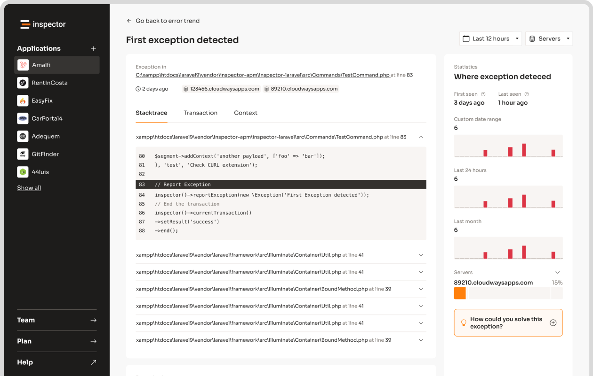

[Symfony Messenger](https://symfony.com/doc/current/components/messenger.html) lets you handle time-consuming tasks in the background, outside of the request/response cycle, keeping your app fast and responsive. Whether you're sending emails, processing data, or interacting with third-party APIs, Messenger helps you execute these operation later in the background. Here’s what you’ll learn in this guide:

- **What Symfony Messenger is**: A tool for managing background tasks using message queues.
- **Why use it**: Improves performance, scalability, and reliability by offloading heavy tasks.
- **How to set it up**: Install Messenger, configure it with [Doctrine](https://www.doctrine-project.org/) and MySQL, and create database tables for message storage.
- **Key features**: Supports multiple transports (Doctrine, [RabbitMQ](https://www.rabbitmq.com/), [Redis](https://redis.io/)), error handling, retries, and monitoring.

Below you can find a the step-by-step setup, learn how to configure workers, and explore error-handling techniques.

Plus, monitor your background tasks in real-time using tools like [Inspector](/). This guide covers everything you need to get started.

## What Is Symfony Messenger

The Symfony Messenger component is a powerful queuing system built into the Symfony framework that allows you to publish and consume messages from a queue provider (AMQP, Redis, or Doctrine).

Messages are simple classes where you can store pieces of information to represent a job to be done when the message will be consumed from the queue later in time.

Here is an example of a message for Symfony messenger:

```
namespace App\Messenger;

class SmsNotification
{
    public function __construct(
        private string $content,
    ) {
    }

    public function getContent(): string
    {
        return $this->content;
    }
}
```

On the other side you can create a handler class that will be in charge to process the message when it is pulled out from the queue.

```
namespace App\Messenger;

use Symfony\Component\Messenger\Attribute\AsMessageHandler;

#[AsMessageHandler]
class SmsNotificationHandler
{
    public function __invoke(SmsNotification $message)
    {
        // ... do some work - like sending an SMS message!
    }
}
```

## How to Set Up Messenger

### Installing Messenger

To get started with have to install the bundle. Run the following command:

```bash
composer require symfony/messenger
```

Also install the doctrine messenger transport with the command below:

```bash
composer require symfony/doctrine-messenger
```

### Configuring Messenger with Doctrine and MySQL

First, update your `.env` file to include the transport DSN:

```yaml
# Add to .env:
MESSENGER_TRANSPORT_DSN=doctrine://default
```

Next, create the necessary database table for storing messages:

```sql
CREATE TABLE messenger_messages (
    id BIGINT AUTO_INCREMENT NOT NULL,
    body LONGTEXT NOT NULL,
    headers LONGTEXT NOT NULL,
    queue_name VARCHAR(190) NOT NULL,
    created_at DATETIME NOT NULL,
    available_at DATETIME NOT NULL,
    delivered_at DATETIME DEFAULT NULL,
    PRIMARY KEY(id)
) DEFAULT CHARACTER SET utf8mb4 COLLATE utf8mb4_unicode_ci ENGINE = InnoDB;
```

Finally, configure your `messenger.yaml` file:

```yaml
framework:
    messenger:
        transports:
            async:
                dsn: '%env(MESSENGER_TRANSPORT_DSN)%'
                options:
                    queue_name: default
```

### Selecting a Transport Option

Symfony Messenger supports various transport options. Here's a quick comparison of commonly used transports:

| Transport | Best For | Scalability |
| --- | --- | --- |
| Doctrine DBAL | Small to medium projects | Moderate |
| AMQP (RabbitMQ) | Large distributed systems | High |
| Redis | High-speed processing | High |

Doctrine DBAL is a good choice for projects already using MySQL, as it integrates easily with existing setups. It also supports features like delayed processing, message prioritization, time-to-live (TTL), and unique message handling.

Once you've configured the transport, Messenger is ready to handle background tasks like email processing or other asynchronous operations.

## Using Symfony Messenger for Background Tasks

### Sending Emails Asynchronously

One of the most common use case is to send emails in the background to avoid the user to wait until the sending operation is done. You can push a message onto the queue with all necessary data to perform the task later in the background.

Start by creating a message class to hold the email details (`to`, `subject`, `content`) and a handler to process the message using `MailerInterface`:

```php
// src/Message/SendEmailMessage.php
class SendEmailMessage
{
    private $to;
    private $subject;
    private $content;
}

// src/MessageHandler/SendEmailHandler.php
class SendEmailHandler implements MessageHandlerInterface
{
    private $mailer;

    public function __construct(MailerInterface $mailer)
    {
        $this->mailer = $mailer;
    }

    public function __invoke(SendEmailMessage $message)
    {
        $email = (new Email())
            ->to($message->getTo())
            ->subject($message->getSubject())
            ->text($message->getContent());

        $this->mailer->send($email);
    }
}
```

Next, configure message routing in `messenger.yaml` to ensure these email messages are processed asynchronously:

```yaml
framework:
    messenger:
        routing:
            'App\Message\SendEmailMessage': async
```

### How Workers Process Messages

Workers handle messages in the background by continuously polling the queue. To start a worker, run:

```bash
php bin/console messenger:consume async
```

You can adjust the number of workers based on your server's capacity to manage heavier workloads.

### Handling Errors and Retries

Symfony Messenger includes a retry mechanism to manage errors. You can customize retry settings in `messenger.yaml`:

```yaml
framework:
    messenger:
        transports:
            async:
                dsn: '%env(MESSENGER_TRANSPORT_DSN)%'
                retry_strategy:
                    max_retries: 3
                    delay: 1000
                    multiplier: 2
```

If a message fails after all retries, it’s moved to the failed queue. To inspect failed messages, use:

```bash
php bin/console messenger:failed:show
```

This configuration ensures messages are processed reliably, even in the face of temporary issues. Proper error handling and monitoring are key to keeping background tasks running smoothly. Up next, we’ll explore how to monitor Symfony Messenger effectively.

## Monitoring Symfony Messenger with [Inspector](/)



Once you've set up Symfony Messenger for handling background tasks, keeping an eye on its operations is crucial. Monitoring helps catch issues early and ensures everything runs as expected.

### Why Monitoring Matters

Keeping tabs on your Symfony Messenger jobs helps you spot failed messages, performance bottlenecks, or memory problems before they grow into bigger issues. It also lets you track resource usage and uncover system-wide problems, ensuring your application stays reliable and efficient.

### What Is the Inspector Library?

Inspector is a monitoring tool designed specifically for [PHP applications](/symfony/), including Symfony Messenger. It provides real-time insights into message processing, tracks errors, measures performance, and sends automated alerts. With its detailed logs and resource usage analytics, Inspector offers a clear view of how your background tasks are performing.

### Setting Up Inspector for Symfony Messenger

To monitor your Symfony Messenger tasks effectively, follow these steps to [integrate Inspector](https://docs.inspector.dev/guides/codeigniter/usage):

**1. Install the Inspector Package**

Run the following command to add Inspector to your project:

```bash
composer require inspector-apm/inspector-symfony
```

**2. Add Your Ingestion Key**

Update the `.env` file with your unique ingestion key:

```env
INSPECTOR_INGESTION_KEY=your_key_here
```

Once configured, Inspector's dashboard provides insights such as:

- **Message processing times**
- **Queue lengths and throughput**
- **Error rates and types**
- **Worker status and overall health**

## Conclusion and Best Practices

### Key Takeaways

Symfony Messenger makes handling asynchronous tasks easier, boosting the scalability and responsiveness of web applications. When paired with Doctrine, it allows you to manage messages efficiently while leveraging your existing database setup. This combination ensures reliable delivery and smooth message processing.

To get the most out of Symfony Messenger, it's important to focus on optimizing its setup and configuration.

### Tips for Using Symfony Messenger

Making the most of Symfony Messenger involves thoughtful decisions about transport options, worker management, and error handling.

**Choosing the Right Transport**

- Use **Doctrine** for database-driven systems.
- Opt for **Redis** when speed is a priority.
- Select **RabbitMQ** for scenarios requiring advanced message routing.

**Worker Configuration**

Set memory limits for workers to avoid resource issues during heavy processing loads.

**Handling Errors**

Keep your application running smoothly by:

- Configuring retries for messages that fail to process.
- Setting up dead-letter queues to store unprocessed messages.
- Using monitoring tools like [Inspector](/) to catch and address issues early.

## FAQs

Here are answers to common questions developers often ask about working with Symfony Messenger:

### What is Symfony Messenger?

Symfony Messenger allows your applications to handle messages both synchronously and asynchronously. It supports various transport options like Doctrine and MySQL, making it flexible for different needs.

### How does Symfony Messenger improve application performance?

It boosts performance by:

- Handling tasks asynchronously
- Distributing workloads efficiently
- Including error handling and retry features

### What transport options are available?

Symfony Messenger supports several transports, including Doctrine, Redis, and RabbitMQ. Each option is tailored for specific scenarios. Check out the "Selecting a Transport Option" section for more detailed comparisons.

### How do I monitor Messenger jobs?

You can use Inspector to track job performance, error rates, and worker health in real time. For setup instructions, refer to the Monitoring section.

### What are common use cases for Symfony Messenger?

Symfony Messenger is great for tasks like:

- **Email Processing**: Sending order confirmations or newsletters asynchronously
- **Data Processing**: Managing large-scale imports or exports
- **Third-party API Synchronization**: Communicating with external services without blocking user requests

### How do I handle failed messages?

There are several ways to manage failed messages:

- **Retry Mechanisms**: Automatically retry failed attempts
- **Dead Letter Queue**: Store messages that couldn't be processed
- **Error Logging**: Record failure reasons for debugging

### What's the recommended worker configuration?

For the best results when using Doctrine and MySQL:

- Set memory limits appropriately
- Configure worker lifetimes
- Ensure proper database connection management

These tips should help you make the most out of Symfony Messenger while keeping your application efficient and reliable.

## Related Blog Posts

- [5 Ways to Optimize Symfony Application Performance](/5-ways-to-optimize-symfony-application-performance/)
- [Symfony file upload examples and best practices](/symfony-file-upload-examples-and-best-practices/)
- [Laravel Logging: Setup and Use](/log-channels-in-laravel-setup-and-use/)
- [Php Base64 encode/decode - best practices and use cases](/php-base64-encodedecode-best-practices-and-use-cases/)
