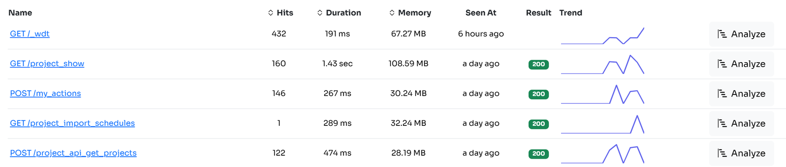
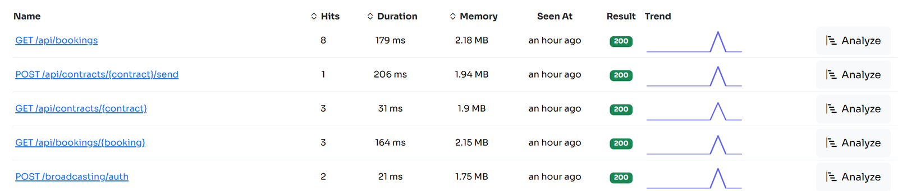
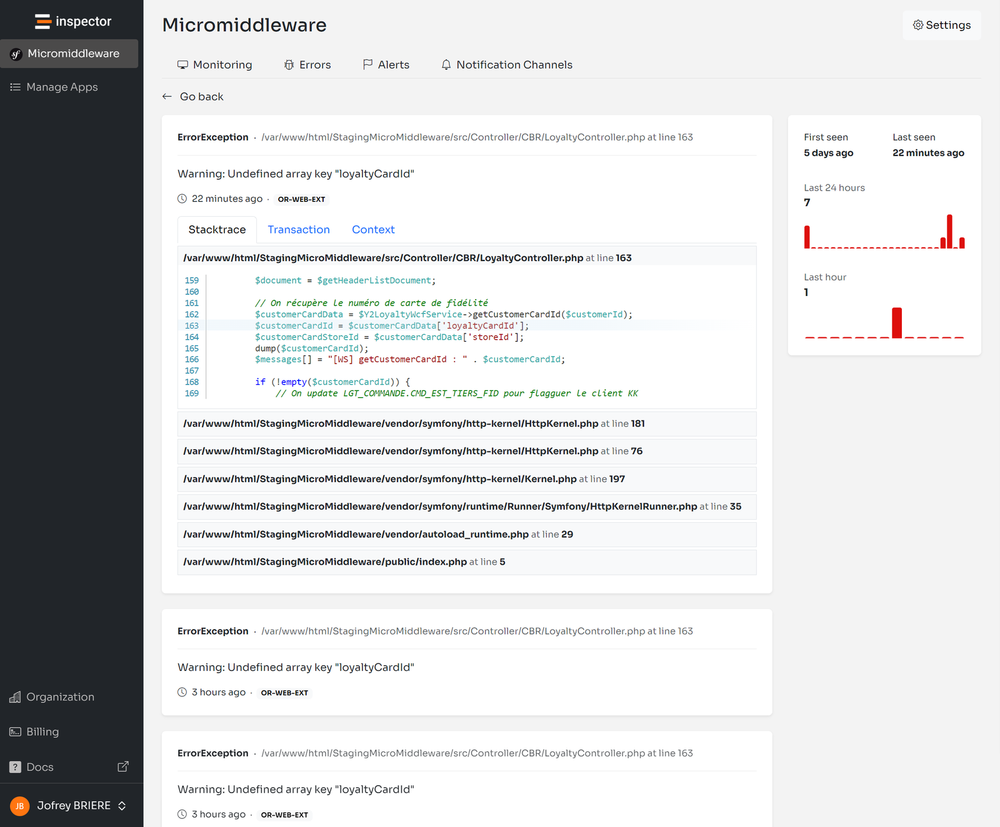

In the last few months I worked heavily to renovate the monitoring experience for Symfony developers. The [**Symfony monitoring library**](https://github.com/inspector-apm/inspector-symfony) is the second most popular library among Inspector’s customers. The first is the [**Laravel package**](https://github.com/inspector-apm/inspector-laravel).

The release of the latest version of the framework brought the opportunity to make the app monitoring experience as easy as never before.

In this article I’ll detail what these changes are, and the impact they have on your monitoring experience in Inspector.

For more technical articles you can follow me on [**Linkedin**](https://www.linkedin.com/in/valeriobarbera/) or **[X](https://x.com/Barbalerio)**.

## Compatibility With Doctrine 3.x

The latest major version of the most important ORM for Symfony was released at the beginning of this year. And it dropped the support for SQL loggers in favor of a new “Middleware Architecture".

We implemented a check inside the bundle to verify what version of Doctrine the application is using to inject a sql logger or a middleware accordingly.

## Collect The Route Name

The first implementation of the Symfony monitoring library was using the name of the route to monitor the http traffic against your Symfony application:



Basically when you implement a new route in Symfony you can declare it via an attribute on the Controller’s method:

```php
namespace App\Controller;

use Symfony\Component\HttpFoundation\Response;
use Symfony\Component\Routing\Attribute\Route;

class HomeController
{
    #[Route('/', name: 'app_homepage')]
    public function home()
    {
        return new Response('Home Page');
    }

    #[Route('/landing', name: 'app_landing')]
    public function landing()
    {
        return new Response('Landing Page');
    }
}
```

The *Route* object gets the name of the route as a second parameter, so you can reference this route inside the application using its name instead of writing the path. This allows you to change the url pattern in the future without the need to change it in every line of code it is mentioned.

And if you want to ignore one of them in your monitoring library you had to list the route name in the Inspector yaml configuration file:

```yaml
inspector:
    ingestion_key: '%env(INSPECTOR_INGESTION_KEY)%'
    ignore_routes:
        - 'app_landing'
```

The first developer who helped me build the first version of the library didn’t find a way to collect the real url pattern, so we continued with this implementation to not block the work.

But using the route’s name to monitor the HTTP traffic has several disadvantages.

## The Problem With Route Names

First the route name is optional. It’s obviously not required to map urls with names in Symfony. So many developers were not using names so as fallback data the library was collecting the ultimate path like: */users/12/profile*.

Even worse, someone uses names only for a part of the application, and they saw the transactions list in the dashboard with mixed formats, some endpoints monitored using the route’s name, and others endpoint with url.

The second problem was the ability to ignore url to turn off monitoring in certain parts of the app. A Symfony application is typically segmented using url patterns. Developers tend to group all the admin endpoints under the main url like **/admin/[other sub urls]** . if you want to ignore parts of your app using wildcards it could be easier if you can reference urls because of this natural association (**/users\***). It’s more tricky to find a more consistent pattern in route names.

Furthermore the fallback data collected in case the route’s name doesn’t exist was the real url like */users/12/profile*. So every time the endpoint was called with a different ID, it generated a new line in the transactions list. Creating too much noise in the monitoring data.

## Collect the Route Pattern

Route Patterns are different from the real url your users are calling. Most of the urls you have in your Symfony app are basically parametrized like */users/{id}/profile*

This is a typical implementation in a Symfony controller:

```php
namespace App\Controller;

use Symfony\Component\HttpFoundation\Response;
use Symfony\Component\Routing\Attribute\Route;

class UserController
{
    #[Route('/users/{id}/profile')]
    public function profile()
    {
        return new Response('Profile Page');
    }
}
```

And this is what we need to report in the transactions list instead of the real url. Because even if the ID change is always the same code to be executed.



This change makes it easier to also ignore not only specific urls but also entire parts of your app using the wildcard character in the Inspector configuration file:

```yaml
inspector:
    ingestion_key: '%env(INSPECTOR_INGESTION_KEY)%'
    ignore_routes:
        - '/admin*'
```

For more technical articles you can follow me on [**Linkedin**](https://www.linkedin.com/in/valeriobarbera/) or **[X](https://x.com/Barbalerio)**.

## Monitor your Symfony application for free

Inspector is a Code Execution Monitoring tool specifically designed for software developers. You don’t need to install anything on the infrastructure, just install the [**Symfony package**](https://github.com/inspector-apm/inspector-symfony) and you are ready to go.

If you are looking for HTTP monitoring, database query insights, and the ability to forward alerts and notifications into your preferred messaging environment try Inspector for free. [**Register your account**](https://app.inspector.dev/register).

Or learn more on the website: [**https://inspector.dev**](/)

[](/)
