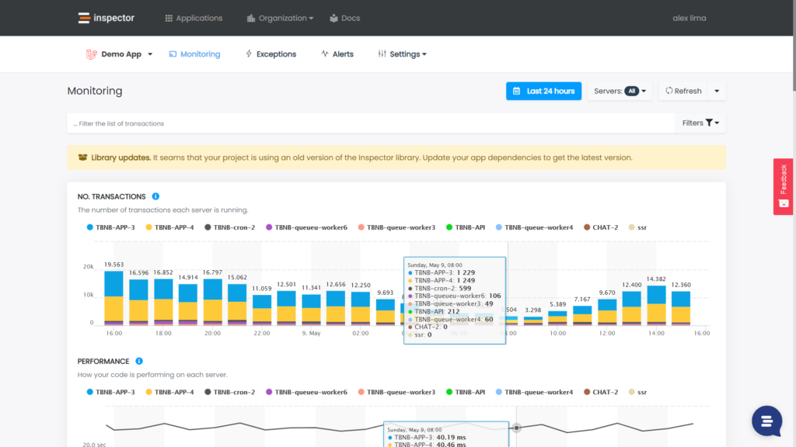
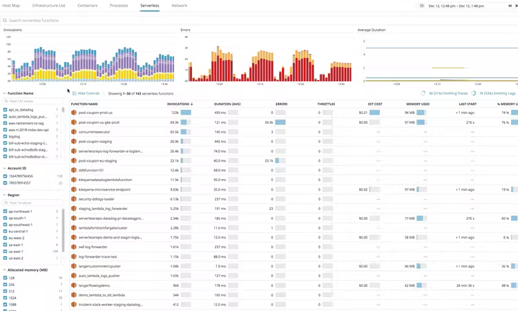
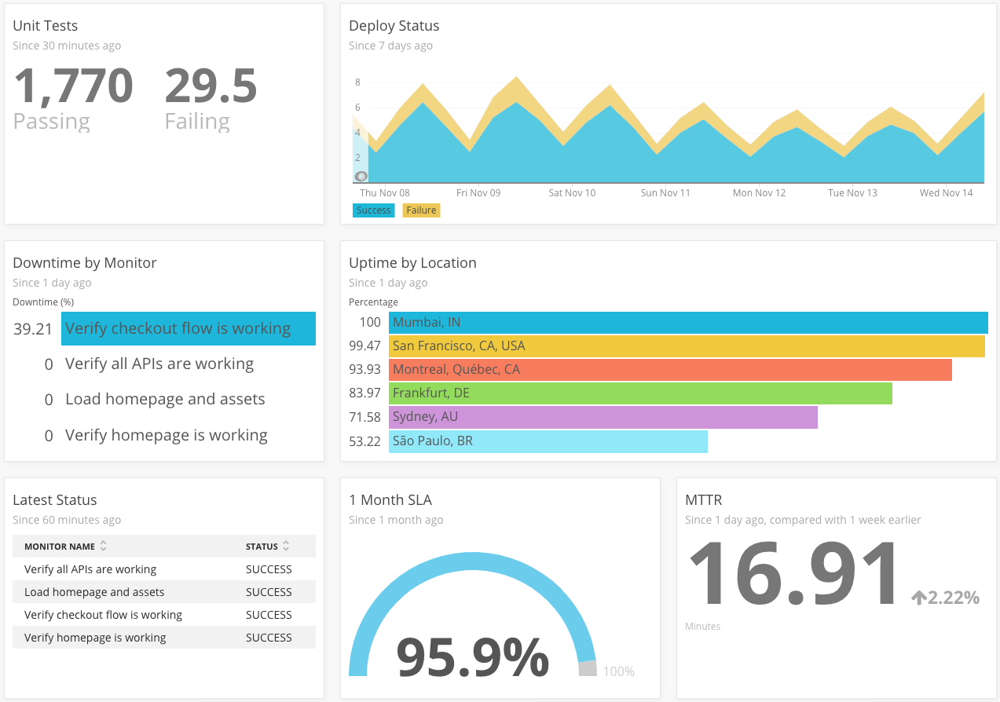
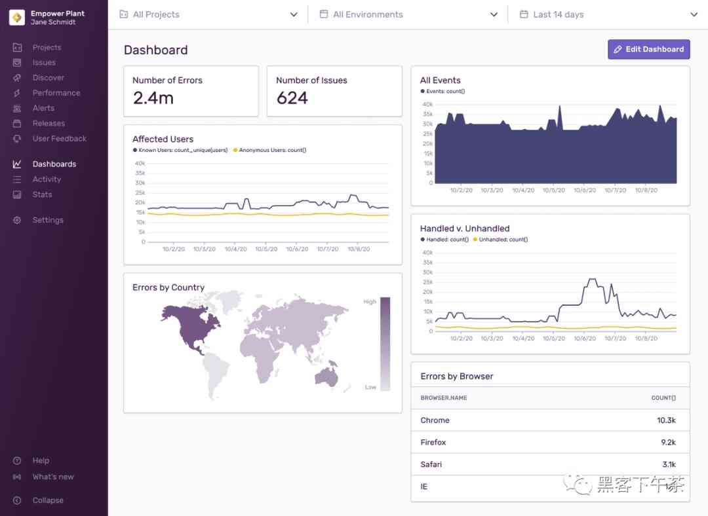
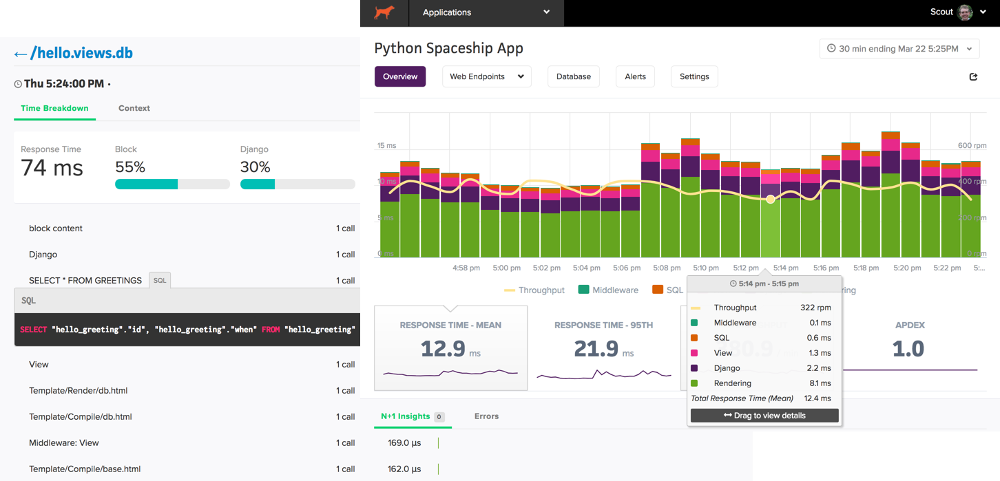

When it comes to application monitoring software, there are some great tools available to make our lives easier. We've compiled a list of the very best.

No offense intended but the truth is customers are no longer interested in what you have to do to make your product work when they need it. They only care about their results.

As a business owner or IT leader, how can you use that to your advantage? You identify and fix technical problems before customers are even aware that a problem exists!

If your customers like you, they’ll be happy to recommend you to their community, and pay their subscription for years to come.

And how can you be so quick to identify and fix bugs?

Application Monitoring of course!

## Why is Monitoring so powerful?

A [Business Wire research](https://www.businesswire.com/news/home/20210216005484/en/Rollbar-Research-Shows-That-Traditional-Error-Monitoring-Is-Missing-the-Mark) reveals that fixing bugs and errors in code is developers’ No. 1 pain point.

Software allows for innovation, industry disruption, and positive outcomes for businesses and society. But it can also leave developers stuck in the weeds.

Manual processes make fixing bugs time consuming and developer work unpleasant. In fact, more than a fourth said they would rather pay bills or spend time with their in-laws 🥺.

The irony is they know they need to invest in automatic monitoring, but because data management platforms are notoriously time-consuming and expensive to adopt and manage, they focus their efforts elsewhere.

The time has come to cease making home made solutions or to delegate bug detection directly to end users.The time has come to cease making home made solutions or to delegate bug detection directly to end users.

As IT managers, there are some great application monitoring tools available to make our lives easier. I’ve compiled a list of the best platforms that can help simplify the monitoring process, save money, and drive sales.

## What are the key differences?

Here's a short summary, but please read on for a deeper comparison:

1. [Inspector](/the-5-best-application-monitoring-tools-for-2022/#inspector) - Best for saving time and easy-of-use, great UX making it simple for all team members. Includes the ability to connect unlimited hosts and applications. Utilizes Notification Channels to forward alerts to a variety of messaging tools (e.g. Mail, Slack, Telegram, Microsoft Teams, and many more). [Free plan available](https://app.inspector.dev/register).
2. [DataDog](/the-5-best-application-monitoring-tools-for-2022/#datadog) - All plans allow unlimited user accounts but it is quite difficult to understand pricing. Great visual organization by dashboards and the ability to record custom metrics. Support for a wide range of technologies. Free plan available.
3. [New Relic](/the-5-best-application-monitoring-tools-for-2022/#newrelic) - Multiple tools inside the same dashboard, lots of great integrations. One of the more affordable starting plans, however expensive to integrate more users. Free plan available.
4. [Sentry](/the-5-best-application-monitoring-tools-for-2022/#sentry) - Fairly simple to use. Born only for error monitoring than extended for performance analytics. Support for customer feedback collection during error reporting. Free plan available.
5. [Scout APM](/the-5-best-application-monitoring-tools-for-2022/#scoutapm) - Compatible with OpenTelemetry standard. Onboarding was a bit confusing with too few code examples and technical information. Free 14 day trial.

## [Inspector](/)

### First Impression

The UX is incredibly simple and it appears that a lot of thought has gone into the design and layout of the tool. I also found this to be the most informative onboarding I have ever experienced.

Inspector makes the process of collecting metrics and setting up notification channels incredibly easy.

Thanks to the automatic process discovery and data segmentation per host, very little tech-savviness is required to have a full overview of what your application is doing and how the underlying hardware resources are used.

### Best features:

- Pre-packaged monitoring strategies for most known application frameworks - useful to get started in minutes avoiding complicated instrumentation
- Ability to filter the list of transactions and save searches as custom reports
- Creating alerts using custom metrics with several threshold detection strategies
- Ability to connect multiple notification channels for each application. You can route different notification in different messaging environments

### Plans and pricing

Beyond the free usage limit Inspector has four standard plans and a customizable Enterprise account:

1. **Developer -** $39/mo can ingest 500K transactions a month, 3 team members and 1 notification channel per app.
2. **Team -** $69/mo can ingest 1.2 million transactions a month, up to 5 team members, and 2 notification channels per app.
3. **Scale -** $99/mo can ingest 3 million transactions a month, up to 10 team members and 3 notification channels per app.
4. **Enterprise -** $169/mo can ingest 6 million transactions a month, up to 15 team members and 4 notification channels per app.

### Summary

Inspector is the only one of these tools focused on reducing complexity. Your application will always be fully monitored, and you will be alerted in real-time if something goes wrong in your code before customers stumble onto the problem.

[Sign up to monitor 30K montlhy transactions with Inspector for free.](https://app.inspector.dev/register)

## [DataDog](https://www.datadoghq.com/)

### First Impression

DataDog allows you to add multiple users even from the free plan. On the other hand the pricing structure of DataDog services is quite complicated. There are a lot of services available in the DataDog platform each of which with a different pricing structure. Take care of this aspect to avoid unexpected costs.

DataDog has great integrations including collectors for specific cloud providers technologies (AWS, Google Cloud, etc.). It also has an impressive use of workspaces.

One particular feature is that its cost scales according to the number of hosts. So it can result in a completely different impact based on the design of your system.

### Best features

- Adding multiple users even on a free plan
- Support a wide range of technologies
- Use workspaces to organize data visualization
- Out-of-the-box threat detection and cyber security analytics

### Plans and pricing

DataDog provides a lot of different services each of which with a different pricing. Here is the one for the Application Monitoring service:

1. APM - $36/host allow 15-minute live search, and 15-day historical search & analytics.
2. APM & Profiler - $48/host for everything included in APM plan, plus advanced features for code level analysis.

### Summary

There was just too much going on. While DataDog has a free plan, if your application runs on multiple hosts, it becomes really expensive at $36 a host!

## [New Relic](https://newrelic.com/)

### First Impression

It’s clearly enterprise oriented, so you should rely on one-to-one call with the sales team to get started. You can customize the visualization environment with a lot of options and this can sometimes make it difficult to find a good balance.

### Best features

- Very detailed analytics so you can see exactly how much engagement you have
- Integrates with large number of technologies
- Multiple monitoring tools inside the same platform

### Plans and pricing

1. **Standard -** $49/core user, $99/full access user
2. **Pro -** talk with the sales team for a custom pricing
3. **Enterprise -** talk with the sales team for a custom pricing

### Summary

New Relic is a real contender to Inspector but I feel the biggest disadvantage is the focus on infrastructure monitoring instead of code level monitoring. While the drill down capabilities are very good, they might still require additional configurations.

## [Sentry](https://sentry.io/welcome/)

### First impression

Sentry has one of the best onboarding processes and a really good documentation. Its strong point remains error monitoring, but it also includes performance analysis.

It’s very straightforward to integrate in your application and it allows you to collect user feedback during application’s crash reporting.

### Best features:

- Easy to follow onboarding
- Collect user feedback during application’s crash reporting
- Library for mobile technologies

### Plans and pricing

1. **Team -** $29/mo includes 50K errors, 100K transactions .
2. **Business -** $89/mo includes 50K errors, 100K transactions and more advanced features like SAML2 and higher compliance certifications.

## [Scout APM](https://scoutapm.com/)

### First Impression

Nobody likes to be bombarded with messages since their first registration, but Scout APM seems a little too sparse in information for users approaching the tool for the first time.

### Best features

- Support for OpenTelemetry standard
- Unlimited applications and hosts in the same account
- Cross transactions filtering

### Plans and pricing

1. **Basic -** $161/mo includes 167K transactions a day, 5K errors a month.
2. **Plus -** $249/mo includes 288K transactions a day, 5K errors a month.
3. **Pro -** $499/mo includes 667K transactions a day, 5K errors a month.

### Summary

One negative I discovered is to take you from a free plan all the way to the first Standard plan on $161 a month. In my opinion, this seems like an enormous jump and a bit unappealing.

## Conclusion

There are some tools here that will be really easy-to-use and I think you will really benefit from. However, I found most of them either have overly complicated UX, or they are pushing me to upgrade, or to enter their competition.

In all honesty, good UX should afford me the opportunity to be left alone. If I can’t manage on my own it seems the problem is more yours than mine!

I can’t finish off without mentioning that I think it’s a bit disappointing that some tools force developers to talk with a sales team instead of giving people a chance to try it without obligation.

## Inspector ticks all the boxes

Rant over, how do I really feel? For me, [Inspector](/testimonials/) seemed like the most suitable software for businesses looking to simplify their monitoring process. Good UX, intuitive onboarding, and super quick to get set up.

As a busy developer, the time and money it saves me when it comes to monitoring and error detection is worth 10x more than the monthly subscription!

Inspector is usable by any IT leader or developer who doesn’t need anything complicated. They just want good automation, and the ability to forward alerts and notifications into their messaging environment.

If you'd like to start monitoring your application for free, [sign up to Inspector](https://app.inspector.dev/register).
