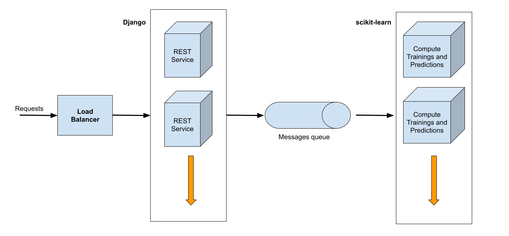

In this article I want to share with you the design of the early version for the upcoming Inspector Machine Learning API architecture.

We will focus on how we want to utilize this new internal system and how the compute layer should works to profile model features and predictions, and perform anomaly detection at scale.

## Motivation

Three years of studying the developers' experiences using Inspector allowed me to be aware the improvements needed to increase the effectiveness of our monitoring platform, while reducing the effort required to be adopted.

Developers tend to look at a lot of coincident data to identify suspicious events and keep them under control over time. They still have to cross-check a lot of information manually, navigate through data and alarm thresholds to classify events or contextual situations as anomalous or not.

An easy to use monitoring platform is crucial to collect this data and make them available clearly and in time.

We want to make Inspector able to identify problematic execution cycles looking at many more parameters than a simple threshold. It must work automatically with a simple initial wizard to make the most of the potential of the algorithms and make the developer much more productive and relaxed.

## Pain Points

Building and distributing a monitoring platform to help software development teams take their products under control, in more than twenty countries, gave me a clear lesson.

Monitoring is crucial to maintain a software product over time, and make the team able to provide technical support for their customers. But the main focus of the team must remain on improving and expanding its core business.

There are many activities in the developers workflow that are functional to the main goal, but are not THE goal. Monitoring is clearly one of them.

So many companies that create dev tools forget this simple fact. Otherwise available products are targeted for too complicated scenarios that are out of scope for small to medium teams. Resulting in not affordable solutions.

Inspector has reached so many customers over the years because it was designed to not introduce unnecessary additional work. We are specialized in monitoring the most important asset for small and medium teams: the code!

We don’t provide metrics for servers, networking, data transfer, etc. You already have a lot of free metrics from your cloud service provider to take these things under control. But it’s not easy for developers to look inside the Code Execution flow. That’s why we named it the Code Execution Monitoring tool.

Designing and implementing new features must take these principles as top priorities.

Easy to use, and help developers to automate code monitoring in a few simple steps.

## The Architecture of the Machine Learning system

The project involves the development of a REST service with a set of APIs designed to work completely decoupled from Inspector. Inspector will be the first user of this service to integrate anomaly detection on the monitoring platform.

The ultimate goal is to develop an API service that can eventually be publicly exposed as a SaaS product.

The service will consist of three macro layers:

- The REST APIs;
- The layer to configure, train and storage ml models;
- Horizontally scalable computing platform for performing predictions on incoming data.

## Design Principles

**Layered-cake approach**: We have customers who need programmatic access via an API, customers who prefer configuring and creating training jobs via a CLI, and customers who prefer interacting with a GUI. We follow a layered-cake approach where all these modes of access are available, with CLI and GUI generally forming a layer on top of the functionality provided by the API.

**Cost visibility**: ML training usually forms a big part of the infrastructure cost. The users using the system should know exactly the cost of a training run. So that they can decide whether the cost is justified based on expected business impact.

**Ease of use**: Given the wide adoption of ML, we can't afford to have users needing to go through complex onboarding. The system should be self-serve even for implementing the advanced aspects of ML such as distributed training and hyperparameter tuning.

## Technology Stack and Machine Learning environment

To have the best opportunities for system evolution, especially on the algorithms side, the service will be developed in Python technology with the Django framework under the hood.

[Django](https://www.djangoproject.com/) should provide the tools to build the REST service, and to easily communicate with the database and other resources connected to the system.

While the Machine Learning layer is powered by [scikit-learn](https://scikit-learn.org/stable/) for access to high-quality, easy-to-use, implementations of popular anomaly detection algorithms.

## Conclusion

The project is in its designing stage and many more constraints will emerge during the implementation. Anyway I believe that this architectural concept will help to take the project in the right direction.

Feel free to comment with your considerations. Any feedback is really appreciated.

## New to Inspector? Try it for free now

Are you responsible for application development in your company? Consider trying my product Inspector to find out bugs and bottlenecks in your code automatically. Before your customers stumble onto the problem.

Inspector is usable by any IT leader who doesn't need anything complicated. If you want effective automation, deep insights, and the ability to forward alerts and notifications into your preferred messaging environment try Inspector for free. [**Register your account**](https://app.inspector.dev/register).

Or learn more on the website: [https://inspector.dev](/)
