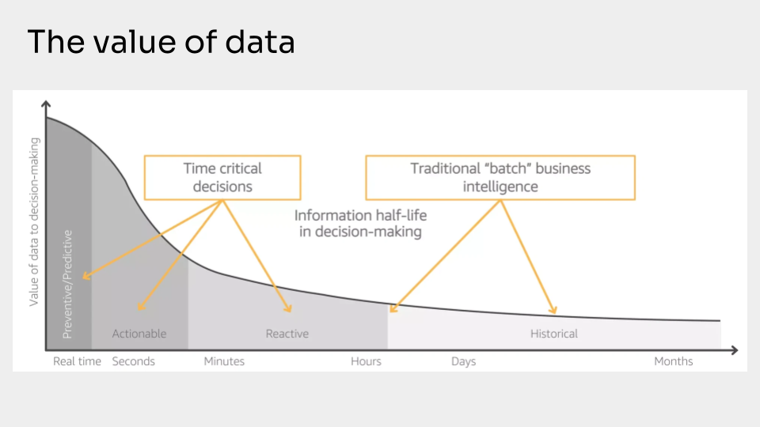

What is the value of data?

That is a huge question.

I could go down so many different rabbit holes and make nuanced points about why data’s valuable.

At a very high level the value of data is that it lowers your level of uncertainty when it comes time to make a decision or solve a critical problem.

Linking data to its contribution is the simplest method to estimate its importance.

The degree of inherent risk can frequently be used to determine its worth: More risk is equal to More value. A huge danger also suggests that data will be valuable in proportion.

**View the full video: [https://www.youtube.com/watch?v=i17Ypoeowio](https://www.youtube.com/watch?v=i17Ypoeowio)**

## Data Use Cases Overtime

This representation describes the value of the data over time.

The initial part of this curve, towards the RealTime, Seconds, or Minutes zone, is where the maximum value is expected from the monitoring tools. Because in this area errors and bottlenecks can generate significant losses for the business, and it is necessary to act quickly.

Monitoring data allows you to spot problems and fix them immediately. It's like having a watchdog that looks for issues that might affect the company's operations or decision-making.

Personally, I don't agree with describing a loss of value of data over time, because in my opinion the purpose for which the data is used actually changes, but that doesn't make it less valuable.

However, I preferred to use this chart anyway because it is the most common representation of this concept.

As data ages, we tend to use it more for planning or trend monitoring purposes, rather than for day-to-day work. But they remain critically important for decision making.

## Bugs can still occur

Monitoring helps you assess if progress is made achieving expected results, spot bottlenecks, or highlight whether there are any unintended effects after any release.

No matter how great your code is, or where you deploy the application, bugs can still occur.

The big question is who discovered the bug. Is it you or your customers?

If the customer gets impacted by the issue it can rate our work as unreliable and could begin exploring other options. However if you are equipped with the right tool you can find those bugs yourself and fix them before they create problems to the customers, providing a fantastic service experience.
