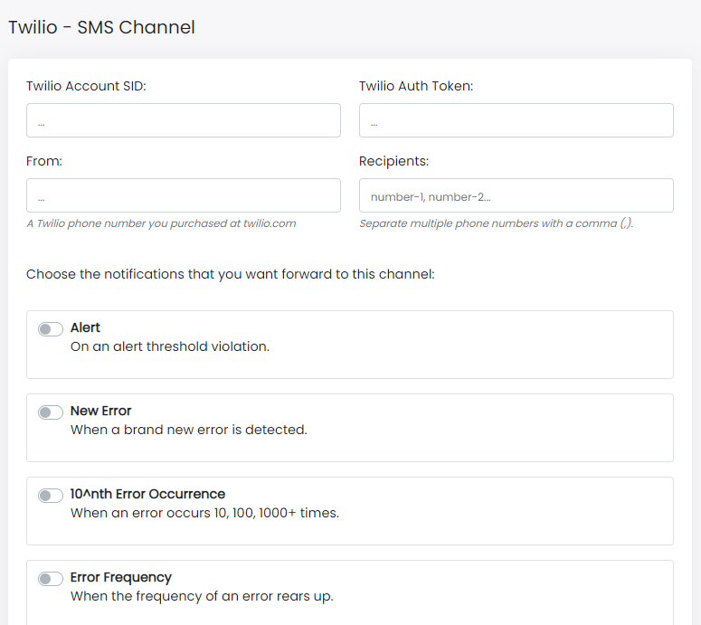

Hi, I'm Valerio software engineer from Italy, and CTO at Inspector.

I am really happy to announce the general availability of our brand new "**Twilio - SMS**" notification channel.

If you are a busy developer you now have one more option to intelligently forward your notificiations directly in your smartphone, stay informed about your application status, and sleep better at night.

## How Twilio Notification Channel Works

We decided to implement this integration in a way that Inspector will connect to your Twilio account on your behalf, so you can keep total control about your credit spent to forward SMS to your mobile number.

We thought carefully about the option to use directly our Twilio account, but we should have revised our rates making them more difficult to understand. Furthermore you could have an existing Twilio account that allows you to access a more convenient price.

## Configuration

You need three mandatory parameters from your Twilio console:

- Account SID
- Auth Token
- From number

You can find these information directly in your Twilio console: **[https://www.twilio.com/console](https://www.twilio.com/console)**.

As recipients you can add as many phone numbers you want to receive selected notifications. Separate each number with a comma ( **,** ), but consider that each number will receive a separate SMS, so each of them contributes to the consumption of your Twilio credit.

For a more complete overview you can rely on our official documentation at: **[https://docs.inspector.dev/notifications/twilio-sms](https://docs.inspector.dev/notifications/twilio-sms)**

## Conclusion

If you are an Inspector user I hope you can find this new channel useful. We continue to make decisions trying to help as many developers as possible to monitor their code execution effortlessly with the easiest Code Execution Monitoring system out there.

If you don't know Inspector yet, you can learn more about its Code Execution Monitoring system for PHP and Nodejs on our website: [https://inspector.dev](/)
