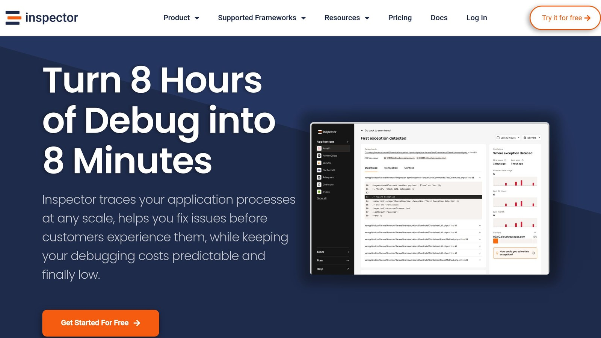

PHP file upload can expose your application to serious risks like host broken files, upload executable files, server overload, and data breaches. Here’s how to secure them:

- **Validate File Types**: Use whitelists, MIME type checks, and file signature validation to block harmful files.
- **Limit File Sizes**: Set strict size limits in `php.ini` and application code to prevent server overload.
- **Sanitize File Names**: Remove special characters and use unique names to prevent overwrites and directory traversal attacks.
- **Store Files Securely**: Keep uploads outside public directories, apply strict permissions, and use unique paths.
- **Monitor Uploads**: Log upload events, track suspicious patterns, and use tools like [Inspector](/) for real-time monitoring.

**Quick Tip:** Combine these techniques with advanced measures like authentication, CAPTCHAs, and CORS policies to further reduce risks. These steps ensure your PHP file upload system is both secure and functional for users.

## PHP File Uploads: The Complete Guide to Uploading Files Using PHP

[PHP File Uploads | The Complete Guide to Uploading Files Using PHP](https://www.youtube.com/watch?v=K_W5ZqwEcqs)

## Key Practices for Safe File Uploads

Securing the PHP file upload process requires addressing various security concerns. Below are critical practices to ensure a secure file upload system.

### Validating File Types

Checking file types is the first step to prevent harmful uploads. A good validation system uses multiple methods to confirm that only approved files are accepted.

| Validation Method | Purpose | Implementation |
| --- | --- | --- |
| Extension Whitelist | Allow specific file types | Define an array of accepted extensions |
| MIME Type Check | Verify actual file content | Use the `finfo_file()` function |
| File Signature | Detect tampered files | Check file headers (unique identifiers) |

Here’s a PHP example for secure file type validation:

```php
// Define allowed file extensions and MIME types
$allowedTypes = ['jpg', 'jpeg', 'png', 'pdf'];
$allowedMimeTypes = ['image/jpeg', 'image/png', 'application/pdf'];

$finfo = finfo_open(FILEINFO_MIME_TYPE);
$mimeType = finfo_file($finfo, $_FILES['upload']['tmp_name']);
$extension = strtolower(pathinfo($_FILES['upload']['name'], PATHINFO_EXTENSION));

if (!in_array($extension, $allowedTypes) || !in_array($mimeType, $allowedMimeTypes)) {
    throw new Exception('Invalid file type');
}
```

These measures help ensure that only safe files are processed, reducing risks from harmful uploads.

### Limiting File Sizes

Setting strict file size limits protects your server from being overloaded by excessively large files, which can lead to denial-of-service (DoS) attacks. Size limits can be enforced in two ways:

- **PHP Configuration:** Adjust the `php.ini` file:

```php
upload_max_filesize = 5M
post_max_size = 6M
```

- **Application-Level Checks:** Add a check in your PHP code:

```php
// Reject files larger than 5MB
if ($_FILES['upload']['size'] > 5242880) {
    throw new Exception('File exceeds maximum size limit');
}
```

By setting these limits, you safeguard your server from resource exhaustion.

### Sanitizing Input Data

Sanitizing file names is essential to prevent directory traversal attacks and ensure secure file storage. Here’s how you can sanitize file names:

```php
// Remove special characters and add a timestamp
$fileName = preg_replace("/[^a-zA-Z0-9.]/", "", basename($_FILES['upload']['name']));
$fileName = time() . '_' . $fileName;
```

This approach avoids vulnerabilities related to file paths or names, ensuring uploaded files are stored safely.

> "To guarantee that hackers do not upload any harmful files to the system, you must secure your input/upload feature."

While these practices protect the upload process, securely storing files is equally important to prevent unauthorized access or misuse. The next section will cover how to store uploaded files safely.

## Safe Methods for Storing Uploaded Files

After validating files, the next step is ensuring they are stored securely to protect your PHP application.

### Keeping Files Outside Public Folders

It's safer to store uploaded files in a directory outside the web root. This keeps them inaccessible from the browser:

```php
// Define secure storage path outside web root
$upload_dir = '/var/secure_uploads/';
$filename = uniqid() . '.' . pathinfo($_FILES['file']['name'], PATHINFO_EXTENSION);

// Securely move uploaded file
if (move_uploaded_file($_FILES['file']['tmp_name'], $upload_dir . $filename)) {
    chmod($upload_dir . $filename, 0644);
}
```

### Renaming Files to Avoid Overwrites

To avoid overwriting files or exposing your system to risks, use a clear naming strategy:

| Naming Component | Example |
| --- | --- |
| Timestamp | 1702234567\_ |
| Random String | a7b9c2\_ |
| Sanitized Name | document.pdf |

```php
$timestamp = time();
$random = bin2hex(random_bytes(8));
$clean_name = preg_replace("/[^a-zA-Z0-9.]/", "", $_FILES['file']['name']);
$new_filename = $timestamp . '_' . $random . '_' . $clean_name;
```

This approach ensures every file has a unique name, reducing the chance of conflicts.

### Setting Secure File Permissions

File permissions play a big role in preventing unauthorized actions. Use `0755` for directories and `0644` for files:

```php
// Set directory permissions
chmod($upload_dir, 0755); // Owner: rwx, Group: r-x, Others: r-x

// Set file permissions
chmod($upload_dir . $filename, 0644); // Owner: rw-, Group: r--, Others: r--
```

These settings allow the server to write files while restricting others to read-only access. It also prevents unauthorized users from modifying or executing files.

Secure storage is crucial, but combining it with [monitoring tools](/how-code-execution-monitoring-can-help-you/) can add an extra layer of protection against potential misuse.

## Advanced Techniques for File Upload

Building on the basics, these advanced methods help fortify PHP applications against file upload vulnerabilities.

### Using Databases for File References

Instead of directly exposing file paths, store file metadata in a database. This approach keeps paths hidden, simplifies access control, and creates an audit trail:

```php
class FileUploadManager 
{
    private $pdo;

    public function storeFileReference($file) {
        $uniqueId = bin2hex(random_bytes(16));
        $stmt = $this->pdo->prepare(
            "INSERT INTO file_uploads (id, name, type, path) 
             VALUES (:id, :name, :type, :path)"
        );

        $stmt->execute([
            ':id' => $uniqueId,
            ':name' => $file['name'],
            ':type' => $file['type'],
            ':path' => '/secure_storage/' . $uniqueId
        ]);

        return $uniqueId;
    }
}
```

**Why use a database for file references?**

| Feature | Benefit |
| --- | --- |
| **Access Control** | Enforce fine-grained permissions |
| **Audit Trail** | Log and track file activities |
| **Metadata Storage** | Store additional security data |
| **Version Control** | Monitor file changes over time |

### Adding Captchas and Authentication

CAPTCHAs can block bots, while authentication ensures only authorized users can upload files. Here's an example:

```php
public function validateUploadRequest() 
{
    if (!$this->auth->isLoggedIn()) {
        throw new SecurityException('Authentication required');
    }

    $captchaResponse = $_POST['g-recaptcha-response'];
    $verifyUrl = 'https://www.google.com/recaptcha/api/siteverify';
    $response = file_get_contents($verifyUrl . '?secret=' . RECAPTCHA_SECRET . 
                '&response=' . $captchaResponse);

    if (!json_decode($response)->success) {
        throw new SecurityException('CAPTCHA verification failed');
    }
}
```

This ensures that only authenticated users and verified human interactions are allowed.

### Applying Strict CORS Policies

CORS (Cross-Origin Resource Sharing) policies prevent unauthorized domains from accessing uploaded files. Here's how to implement it:

```php
public function setSecureHeaders() 
{
    header('Access-Control-Allow-Origin: https://trusted-domain.com');
    header('Access-Control-Allow-Methods: POST');
    header('Access-Control-Allow-Headers: Content-Type');
    header('Access-Control-Max-Age: 86400');
    header('Content-Security-Policy: default-src "self"');
}
```

By restricting origins and methods, you limit exposure to unauthorized cross-origin requests.

These advanced techniques strengthen your application's defenses. Combined with monitoring tools, they help safeguard against evolving threats.

## Monitor For Errors With [Inspector](/)



Adding real-time monitoring tools like **Inspector** can help boost security for PHP applications, providing an extra layer of protection alongside advanced techniques.

### Real-Time File Upload Monitoring

Inspector keeps a close eye on file uploads as they happen, spotting unusual activity instantly. Its smooth integration with PHP frameworks like [Laravel](https://laravel.com/) and [Symfony](https://symfony.com/) allows for quick threat detection without requiring complicated setups.

```php
use Inspector\Inspector;
use Inspector\Configuration;

$inspector = new Inspector(
    new Configuration('your_app_key')
);

$inspector->startTransaction('file-upload');

$file = $inspector->startSegment(function () {
    // Upload and store your your file...
}, 'file');

$record = $inspector->startSegment(function () {
    // Add a record on the database...
}, 'query');

$inspector->transaction()->end();

// Any error will be automatically reported on the Inspector dashboard
```

### Key Benefits Of Monitoring PHP File Upload

Inspector includes several tools designed to improve file upload security. Here's a quick breakdown:

| Feature | Benefits |
| --- | --- |
| [HTTP Traffic Monitoring](/laravel-real-time-performance-monitoring-using-inspector-part-1/) | Detects repeated failed upload attempts, signaling potential brute-force attacks |
| Background Task Visualization | Tracks file processing to uncover suspicious activity |
| Error Detection | Quickly flags validation issues or security breaches |
| [Automated Bug Fix Proposals](https://docs.inspector.dev/concepts/ai-bug-fixer) | Suggests actionable fixes for vulnerabilities in upload handlers |

### Install Inspector in Your Preferred Framework

If your application is built on top of a framework you can use our first party packages for [**Laravel**](https://github.com/inspector-apm/inspector-laravel) and [**Symfony**](https://github.com/inspector-apm/inspector-symfony).

They offer a complete monitoring experience without the need of any configuration. You can connect your first application for free.

### Automated Security Alerts

Inspector sends alerts about potential risks like failed validations, unauthorized access attempts, or unusual upload patterns. These automated notifications work alongside manual validation methods, reducing the chance of missing security issues.

### Performance Insights

Inspector also pinpoints performance bottlenecks in upload workflows, such as slow validation processes or resource constraints. This ensures the upload system runs efficiently while staying secure, striking a balance between protection and performance.

## Summary of File Upload Security Tips

Securing file uploads in PHP requires multiple layers of defense, including validation, safe storage, and continuous monitoring. Let’s break down the key practices.

**Core Security Practices**

File validation is crucial to prevent harmful uploads. This includes checking the MIME type and using magic number verification. Inspecting the actual content of files adds an extra layer of protection against more advanced threats.

**Safe Storage and Access Restrictions**

Storing files securely and controlling access are vital. Below is a quick guide to essential storage measures:

| Security Layer | Implementation Details | Purpose |
| --- | --- | --- |
| File Location | Store files in non-public folders | Prevent direct URL-based access |
| File Permissions | Apply strict read/write settings | Minimize unauthorized system use |

**Continuous Monitoring**

Using tools like Inspector can help track unusual upload activity and send alerts in real time. Combining proactive monitoring with these techniques strengthens your ability to counter new risks.

**Managing Resources**

Adjust PHP settings, such as upload size limits, to prevent resource overload. Tailor these limits to your application's specific requirements to ensure both security and efficiency.

Security isn’t a one-time task - it’s an ongoing effort. Regularly review logs, update validation rules, and keep up with emerging threats. By combining these steps with monitoring tools, you can build a strong defense for file uploads in your PHP applications.

## FAQs

### How do you handle file uploads securely in PHP?

To handle file uploads securely in PHP, you need to focus on validation, safe storage, and monitoring. Here's a quick breakdown:

| Security Layer | Implementation | Purpose |
| --- | --- | --- |
| **File Validation** | Use PHP's built-in validation tools | Ensure uploaded files are safe |
| **Storage Location** | Keep files outside the web root | Block direct access to files |
| **Access Control** | Restrict access with `.htaccess` | Add an extra layer of protection |
| **Size Management** | Set `upload_max_filesize` in PHP | Avoid overloading the server |

> "The Content-Type header can be spoofed. Use PHP's ***finfo*** to validate file content accurately".

### How to securely upload files in PHP?

Secure PHP file upload requires a combination of validation, secure storage, and strict access controls. Here's how you can tackle each area:

**File Validation**

- Allow only specific file types by using a whitelist of extensions.
- Check file content using PHP functions like ***finfo***.
- Apply multiple layers of validation to minimize risks.

**Storage Security**

- Save uploaded files in directories that aren't directly accessible to the public.
- Use unique filenames to avoid overwriting or guessing file paths.
- Limit file permissions to reduce unauthorized access.

**Access Management**

- Restrict uploads to authenticated users only.
- Add CAPTCHA to block bots from abusing upload forms.
- Enforce CORS policies to control cross-origin requests.

For an added layer of protection, tools like Inspector can monitor file upload activities in real-time. They can alert you to suspicious behavior or potential threats as they happen.
