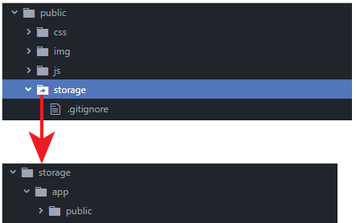

You can upload file in Laravel using its beautiful unified API to interact with many different types of storage systems, from local disk to remote object storage like S3.

As many other Laravel components you can interact with the application filesystem through the Storage Facade: *Illuminate/Support/Facades/Storage*

This class allows you to access storage drivers called disks that implement a common interface. So you can change the underlying physical storage without touching your application code.

This allows you to not only read and write from your local file system, FTP, or AWS S3 in the same way, but also choose a different option depending on whether you are developing in the local environment or running the application in production.

If you want learn how to build your custom Facade, read the article below:

[How to extend Laravel implementing custom Facade – Tutorial](/how-to-extend-laravel-with-driver-based-services/)

For more technical articles you can follow me on [**Linkedin**](https://www.linkedin.com/in/valeriobarbera/) or **[X](https://x.com/Barbalerio)**.

## Configuring storage disks in Laravel

Laravel manages access to the storage via “disks” configured in the **config/filesystems.php** configuration file. Each disk has an identifying name and a driver that allows you to define the actual type of storage system that will be connected to the application.

Depending on the driver, other options will then be configurable. For example, disks with local drivers require setting the *root* parameter to indicate which actual local directory they correspond to. Those with s3 drivers require setting the various keys, secrets, regions and buckets to access AWS S3 or S3 compatible systems.

## The Public Disk

Among the various disks configured by default, the one named *public* is one of the most interesting. This disk is designed to host those files that must be made publicly accessible by the Laravel application.

```php title="config/filesystems.php"
'public' => [
    'driver' => 'local',
    'root' => storage_path('app/public'),
    'url' => env('APP_URL').'/storage',
    'visibility' => 'public',
],
```

As you can see in the snippet above the disk has local as driver and the root is the private *storage/app/public* directory.

How can a private directory be publicly accessible?

To allow the public disk to work you have to create a symlink to connect the Laravel public folder to the private root configured in the disk.



Luckily Laravel has a built-in command to do this setup automatically.

```bash
php artisan storage:link
```

You should run this command the very first time you install your Laravel application on a machine, including your local environment.

When you create a symlink Laravel connects the *storage/app/public* folder to *public/storage* folder. That means if you want to display a file in public page you can do:

```php
{{ asset('storage/file.txt') }}
```

The file is physically stored in storage/app/public, but thanks to the symlink you can access it from the path *yourdomain.com/storage/filename.ext*

This is needed because the public folder is usually the root of the web server (Apache, NGINX, etc), so it is the only path that your website or app can point to. The symlink makes a portion of the storage folder available to the outside.

## Upload file in Laravel

Here is an example of HTML form to allow file uploading:

```php
<form action="/avatar" method="POST" enctype="multipart/form-data"> 
    {{ csrf_field() }}
	
    <input type="file" name="avatar"/>
	
    <button type="submit"></button> 
</form>
```

Saving this file to disk is very easy. The request object has the *file* method that allows you to get items sent from form field of type *file*. You can get the item passing the name of the input field into the file method to access the file sent from the frontend.

```php
namespace App/Http/Controllers;

use App/Http/Resources/UserResource;

class AvatarController extends Controller 
{
    public function update(Request $request)
    {
        $path = $request->file('avatar')->store("avatars/{$request->user()->id}");
		
        $request->user()->update(['avatar' => $path]);

        return new UserResource($request->user());
    }
}
```

The store method gets the file from the request and saves it on the disk generating a unique ID for the file name, while the file extension is retrieved from the MIME type provided in the request. It returns the path of the saved file, which can therefore be saved or used.

**store** will use the default disk configured in *config/filesystem.php* but you can eventually specify a different disk on the fly:

```php
$path = $request->file('avatar')
    ->store("avatars/{$request->user()->id}", 's3');
```

## Upload file using the Storage facade

The same result can be achieved using the Storage facade directly:

```php
$path = Storage::disk('s3')
    ->putFile("avatars/{$request->user()->id}", $request->file('avatar'));
```

I personally prefer to use the Storage facade because it makes the statement more explicit.

For more technical articles you can follow me on [**Linkedin**](https://www.linkedin.com/in/valeriobarbera/) or **[X](https://x.com/Barbalerio)**.
