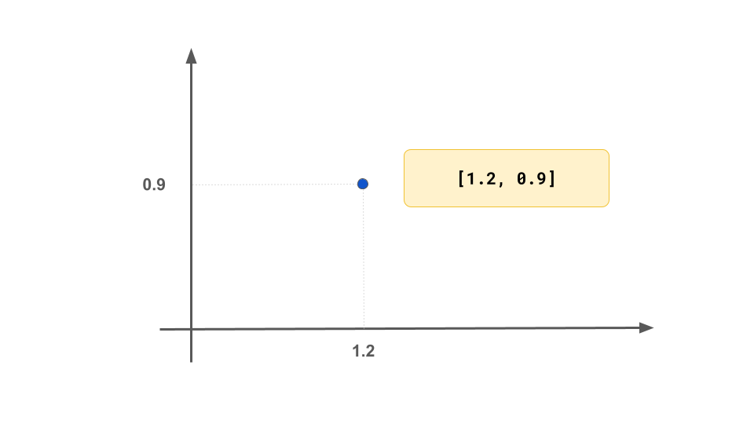
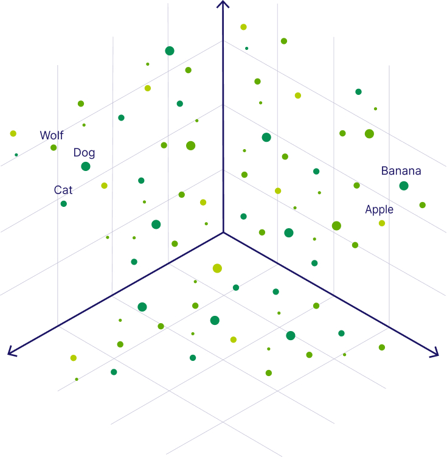
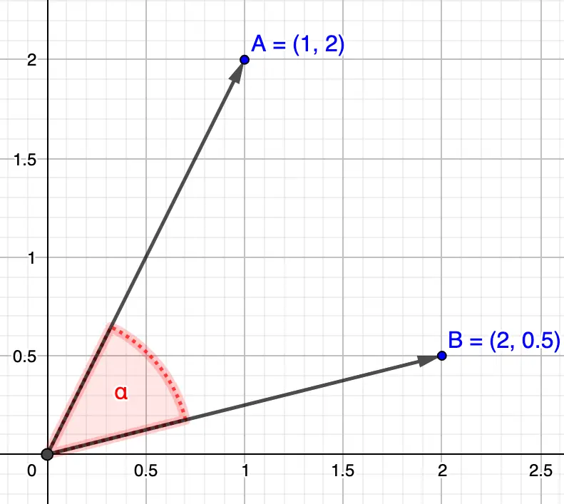
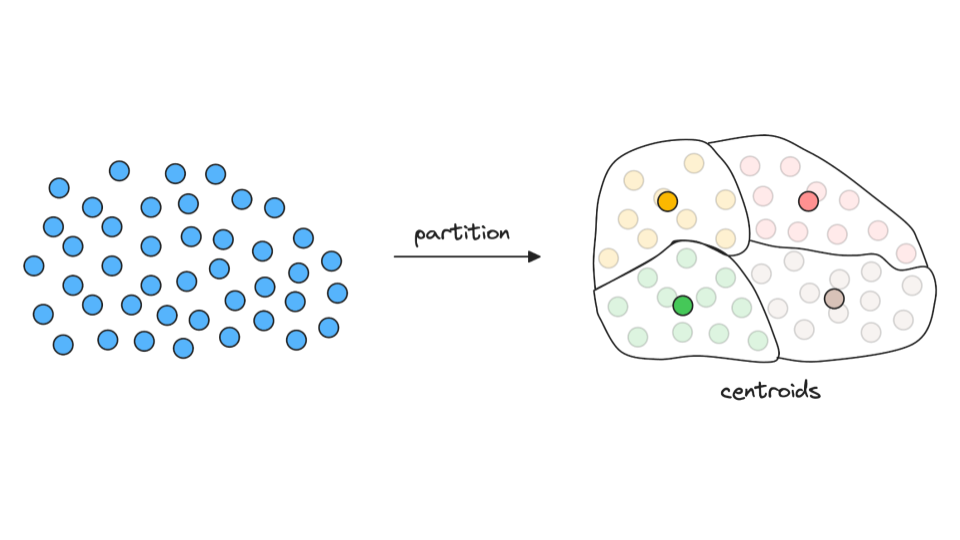

When I first encountered a vector store while working on [Neuron AI](/langchain-alternative-for-php-developers/), the ADK (Agent Development Kit) for PHP, I'll admit I made the same assumptions that many web developers make when they hear the term "database". The natural inclination is to think in familiar terms – tables, rows, columns, SQL queries, user records, and all the structured data patterns we've grown comfortable with over years of building web applications. But vector stores represent something fundamentally different, and understanding this difference is crucial for anyone stepping into the world of AI agent development.

The confusion often begins with how vector databases are marketed and discussed in AI circles. You'll frequently hear them described as "the database for AI agents," which immediately triggers our existing mental models. If you're building an AI-powered customer service agent, for instance, your first instinct might be to think you need to store your customer records, user preferences, and application data in a vector store. This seems logical – after all, if it's the database for AI agents, shouldn't it hold the same kind of structured information that powers your traditional applications?

This misconception runs deeper than just terminology. When we think about databases in the context of web development, we think about storing records, relationships, and structured information that we can query with precision. We ask questions like "Show me all users who signed up in the last month" or "Find all orders over $100 for customer ID 12345." These queries have definitive, binary answers – either a record matches our criteria or it doesn't. The database returns exact matches based on explicit conditions we've defined.

Vector databases operate on an entirely different principle. Rather than storing structured facts about your users or application data, they store the semantic meaning of text chunks – the conceptual essence of information rather than the information itself. When you insert text into a vector store, the system doesn't care about the literal words it contains in the way a traditional search index might.

Instead, it requires that text to be transformed into a mathematical representation that captures its meaning, context, and conceptual relationships to other pieces of text. This representation consists of a series of numbers called vector embeddings.

For developers who have spent years thinking about data in terms of strings, integers, and relational tables, the idea that we can somehow capture the "meaning" of text in an array of floating-point numbers feels almost mystical.

The struggle is understandable. In traditional web development, we've grown accustomed to exact matches and structured queries. When a user searches for "red shirt" in an e-commerce application, we look for products where the description contains exactly those words, perhaps with some basic stemming or fuzzy matching. The relationship between the query and the data is transparent and predictable. But vector embeddings operate on an entirely different principle.

## Introduction To Vector Embeddings

To grasp vector embeddings, we need to abandon our attachment to exact string matching and embrace a fundamentally different way of thinking about text similarity. Imagine trying to explain to someone why "automobile" and "car" mean essentially the same thing, or why "happy" is more similar to "joyful" than to "purple." These relationships exist in the realm of meaning rather than literal character sequences, and vector embeddings are the mathematical tool to perform these queries.

Vector embeddings work by representing each piece of text as a point in a high-dimensional mathematical space—typically containing hundreds or even thousands of dimensions.

You probably remember how to represent a point on a chart with the classical two dimentìsions.

In the case of a multidimensional vector it’s an array of thousands of numbers that ideally represents a lot of axes. It’s a mathematical concept since it doesn’t make so much sense because in the real world we can represent basically anything in a 3D space.

The more dimensions (aka more numbers) the vector has, the more accurately the meaning of a piece of text can be represented.

While we cannot visualize these spaces directly, we can think of them as vast landscapes where semantically similar concepts cluster together. In this space, "dog" and "wolf" end up positioned close to each other, not because they share letters, but because they appear in similar contexts across the vast corpus of text used to train the embedding model.

This contextual understanding is what makes vector embeddings so powerful for AI agents. When a user asks your agent about "troubleshooting connection issues", the system doesn't just look for documents containing those exact words. Instead, it finds content about "network problems", "connectivity failures", or "debugging communication errors"—all of which occupy nearby regions in the embedding space despite using completely different terminology.

This fundamental shift from storing data to storing meaning changes everything about how you interact with the database. Instead of asking "Find all documents with the exact phrase 'customer complaint,'" you might ask something more nuanced like "Find content that expresses customer dissatisfaction or frustration." The vector database doesn't look for literal matches but rather searches for text that shares similar semantic space – content that means something similar, even if it uses completely different words.

## Vector Store Performs Retrieval - Not Queries

During my work with [Neuron AI ADK](https://github.com/inspector-apm/neuron-ai), I've seen countless developers struggle with this conceptual leap. They approach vector stores with SQL-like thinking, trying to create precise queries for exact matches, when the real power lies in the system's ability to understand and match meaning across different expressions of similar concepts. A customer might say "This product is terrible," "I'm not happy with my purchase", or "This didn't meet my expectations", and a well-configured vector store will recognize these as semantically similar expressions of dissatisfaction, even though they share no common keywords.

The queries you perform against vector stores are fundamentally different beasts altogether. Rather than the precise, boolean logic of SQL where conditions are either true or false, vector queries operate in the realm of similarity and proximity. You're not asking "Does this record exactly match my criteria?" but rather "What stored information is most similar in meaning to what I'm looking for?" The database returns results ranked by their conceptual closeness to your query, opening up possibilities for discovery and connection that traditional databases simply cannot provide.

This semantic approach becomes particularly powerful when working with AI agents because it mirrors how human understanding actually works.

When someone asks your customer service agent about "billing issues," they might actually be referring to payment problems, invoice discrepancies, subscription concerns, or pricing confusion. A traditional database would require you to anticipate and explicitly map all these variations, but a vector store naturally understands the conceptual relationships between these different expressions of the same underlying concern.

This contextual awareness becomes the foundation for building AI agents that can understand not just what users are saying, but what they actually mean.

As we prepare to dive deeper into the internal mechanics of vector databases and the sophisticated algorithms that power their similarity searches, it's important to hold onto this fundamental understanding: you're not just adopting a new type of database, you're embracing an entirely different paradigm for how information is stored, organized, and retrieved.

## Vector Store Similarity Search

Understanding similarity search requires us to think about how machines can mathematically represent the concept of "closeness" between ideas. In traditional databases, we're accustomed to exact matches – either two values are identical or they're not. But in the realm of vector databases, we're dealing with degrees of similarity.

The actual search process operates through various distance metrics, with cosine similarity being perhaps the most intuitive to understand. Imagine each piece of text as a point in space, with the angle between any two points representing how similar their meanings are. When you perform a query, the system calculates these angles between your search vector and every stored vector, returning the ones with the smallest angles – essentially finding the content that points in the most similar semantic direction.

What makes this particularly powerful for AI agent development is how similarity search handles the messiness of human language. Traditional keyword search would miss the connection between "I can't access my account" and "login problems," but similarity search recognizes these as variations of the same underlying issue. The mathematical representation captures not just the words themselves, but the relationships, context, and intent behind them, allowing for discovery of relevant information even when the surface-level language is completely different.

The performance characteristics of similarity search also differ dramatically from traditional database queries. Instead of the binary speed of indexed lookups, you're dealing with computational complexity that scales with the size of your vector space and the dimensionality of your embeddings. This is where the sophisticated algorithms we'll explore next become crucial – techniques like approximate nearest neighbor search that make similarity search practical at scale while maintaining the semantic richness that makes vector databases so powerful for AI applications.

## Performance Optimization Indexing Around Centroids

Vector stores clusters the index vectors according to their relative proximity. For each cluster, they then identify its centroid, the center of gravity of that cluster, a high-dimensional point minimizing the distance with every vector in the cluster.

We then structure the data on storage by placing each vector in a file named like the centroid it is closest to.

When processing a query, we then can then focus on relevant vectors by looking only in the centroid files closest to that query vector, effectively pruning the search space.

## Resources

If you are getting started with AI Agents, or you simply want to elevate your skills to a new level here is a list of resources to help you go in the right direction:

- **Neuron AI - Agent Development Kit for PHP**: [https://github.com/inspector-apm/neuron-ai](https://github.com/inspector-apm/neuron-ai)
- **Newsletter**: [https://neuron-ai.dev](https://neuron-ai.dev)
- **E-Book (Start With AI Agents In PHP)**: [https://www.amazon.com/dp/B0F1YX8KJB](https://www.amazon.com/dp/B0F1YX8KJB)

## Conclusion

The journey from traditional web development to AI agent development requires more than just learning new syntax or frameworks – it demands a fundamental shift in how we think about data, search, and user interaction. Vector databases represent one of the most significant paradigm shifts in this transition, moving us away from the rigid precision of SQL queries toward the fluid, contextual understanding that mirrors human cognition.

If you're ready to put these concepts into practice, I encourage you to explore implementing your first Retrieval-Augmented Generation (RAG) system using Neuron AI ADK for PHP. The framework provides an accessible entry point for PHP developers to experiment with vector databases and semantic search without getting overwhelmed by the underlying complexity.

Create a RAG with Neuron AI: [**https://docs.neuron-ai.dev/rag**](https://docs.neuron-ai.dev/rag)
