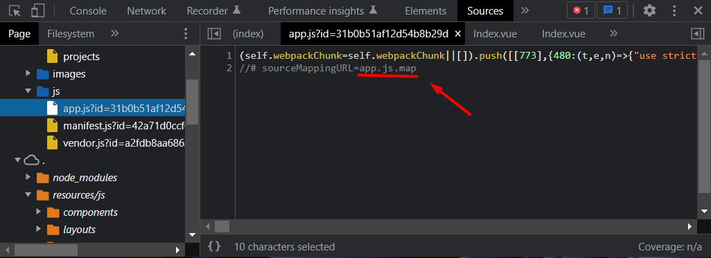
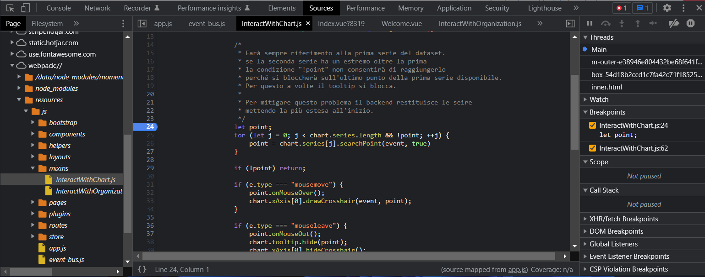

Source maps are useful when you are debugging a web app for a client but the minified version of the Javascript and CSS code makes it impossible to understand what statements the browser is actually executing.

You could break down the original code line by line in your editor putting some “**console.log()**” statements here and there, or try debugging it from its transformed state.

This is where you could benefit from embracing the use of source maps as a handy tool in your developer toolbox. Much like the name implies, source maps offer a way to map code within a compressed Javascript file back to the original position in a source file, and they offer aid in the department of debugging as well. These are a useful, quick, and straightforward way to figure out how to debug a browser as well as easily read compiled scripts.

So, how exactly do source maps work?

## What are Source Maps?

Source Map is a file that maps transformed or transpiled code back to the original source. It allows developers to debug transpiled code in developer tools such as Chrome Developer Tools or Firefox Developer Tools by looking at the original source code including the original line numbers, column numbers, function names, and identifiers that may have been changed during minification or transpiling.

Below is an example of a source map:

```json
{
  "version": 3,
  "sources": ["../src/index.js"],
  "names": ["Celebrate", "ReactDOM", "render", "document", "getElementById"],
  "mappings": "AAAA,MAAMA,SAAS,GAAG,MAAM;AACtB,sBAAO,oFAAP;AACD,CAFD;;AAIAC,QAAQ,CAACC,MAAT,eACE,oBAAC,SAAD,OADF,EAEEC,QAAQ,CAACC,cAAT,CAAwB,MAAxB,CAFF",
  "sourcesContent": [
    "const Celebrate = () => {\n  return <p>It's working! 🎉🎉🎉</p>;\n};\n\nReactDOM.render(\n  <Celebrate />,\n  document.getElementById('root'),\n);"
  ]
}
```

It's just JSON data!

After compiling the code, it will be unreadable to humans as it has been adapted for the computer to take up less space for transfer across the network and improve execution performance.

When the compressed Javascript or CSS files are linked back to their original source the browser will be able to show the precise line of code that the error is occurring within.

This makes debugging much easier.

There are three types of source map you can generate that satisfies different needs.

### Inline source map

Inline source maps are simply data URLs that contain the JSON object we saw earlier encoded in base64. It will look something like this:

```php
//# sourceMappingURL=data:application/json;charset=utf-8;base64,eyJ2ZXJzaW9uIjozLCJzb3VyY2VzIjpbIi4uL3NyYy9pbmRleC5qcyJdLCJuYW1lcyI6WyJDZWxlYnJhdGUiLCJSZWFjdERPTSIsInJlbmRlciIsImRvY3VtZW50IiwiZ2V0RWxlbWVudEJ5SWQiXSwibWFwcGluZ3MiOiJBQUFBLE1BQU1BLFNBQVMsR0FBRyxNQUFNO0FBQ3RCLHNCQUFPLG9GQUFQO0FBQ0QsQ0FGRDs7QUFJQUMsUUFBUSxDQUFDQyxNQUFULGVBQ0Usb0JBQUMsU0FBRCxPQURGLEVBRUVDLFFBQVEsQ0FBQ0MsY0FBVCxDQUF3QixNQUF4QixDQUZGIiwic291cmNlc0NvbnRlbnQiOlsiY29uc3QgQ2VsZWJyYXRlID0gKCkgPT4ge1xuICByZXR1cm4gPHA+SXQncyB3b3JraW5nISDwn46J8J+OifCfjok8L3A+O1xufTtcblxuUmVhY3RET00ucmVuZGVyKFxuICA8Q2VsZWJyYXRlIC8+LFxuICBkb2N1bWVudC5nZXRFbGVtZW50QnlJZCgncm9vdCcpLFxuKTsiXX0=
```

This is a special comment placed in your normal JavaScript file to tells your browser how to link the compiled code to the original version.

### External source map

Source map can be also placed in a separate file. It’s handy for production usage as then loading source maps is optional.

Here is an example of how an external source map is declared directly from the code of the Inspector frontend:



Maybe you don't want to generate a source map for your production bundle as this makes it effortless to inspect your application. By disabling source maps, you are performing a sort of obfuscation.

Whether or not you want to enable source maps for production, they are handy for staging. Skipping source maps speeds up your build as generating source maps at the best quality can be a complicated operation.

### Hidden source map

Hidden source maps give stack trace information only. You can connect them with a monitoring service to get traces as the application crashes allowing you to fix the problematic situations. While this isn't ideal, it's better to know about possible problems than not.

## How to Use Source Maps

All modern browsers offer complete support for source map. If you are using Google Chrome, you can easily see it by clicking on the "Sources" tab in the Chrome dev tools.

As seen in the image below, you can insert a breakpoint in your original code, and Chrome dev tools will automatically map that breakpoint to the minified line of the source file during execution.



The developer tools for both Chrome and Firefox have built in support for source maps making it even easier to trace the compressed files and debug any errors.

### Google Chrome

Chrome is set up very efficiently when it comes to source maps as Google had a large hand in source map specification. It is quite geared toward debugging and that gives it a slight edge on that aspect. Chrome offers a [debug extension](https://developer.chrome.com/docs/devtools/javascript/source-maps/) for inline and external source maps.

### Mozilla Firefox

When using the Firefox developer tools for source mapping, the process is somewhat similar without the addition of the extension straight into the browser. You would want to generate the source map and [include a comment](https://firefox-source-docs.mozilla.org/devtools-user/debugger/how_to/use_a_source_map/index.html) that would point to the source map.

This would allow the process of being able to see the uncombined script and make debugging much easier, similarly with Chrome.
