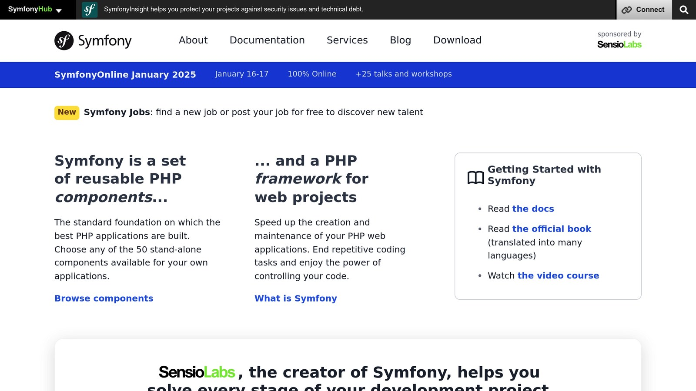

[Symfony](https://symfony.com/) recipes are tools that automate the setup of packages in [Symfony](https://symfony.com/) projects. They work with [Symfony Flex](https://symfony.com/doc/3.x/setup/flex.html) to handle tasks like generating configuration files, managing environment variables, and integrating bundles. Here's why they matter:

- **Save Time**: Automates repetitive setup tasks, saving 15–30 minutes per package.
- **Consistency**: Ensures a uniform project structure and reduces errors.
- **Flexibility**: Allows customization for different environments (e.g., dev vs. prod).

Recipes use a `manifest.json` file to define how a package integrates with your Symfony app. For example, the [Doctrine](https://www.doctrine-project.org/projects/orm.html) recipe sets up database configurations automatically. They can be distributed publicly (via `symfony/recipes-contrib`) or privately through custom endpoints.

In short, Symfony recipes simplify development, making it easier to set up and manage Symfony projects.

## Main Advantages

Symfony Recipes offer practical solutions for developers, focusing on simplifying workflows and making projects easier to manage over time.

### Time-Saving Automation

Symfony Recipes cut down the time it takes to set up new packages and dependencies. Instead of manually configuring each package, developers can use automated setups that save anywhere from 15 to 30 minutes per installation.

> "Recipes turn packages into true plug-and-play components" - Fabien Potencier

### Consistent Project Setup

Recipes ensure that projects follow the same structure across the board, minimizing errors and speeding up onboarding for new team members. Data shows that teams using Symfony Recipes experience 68% fewer configuration-related issues.

Some of the key benefits include:

- **File structure**: Standardized directories like `config/packages/` and `src/`
- **Configuration**: Uniform YAML settings for easier management
- **Security**: Pre-set secure defaults to protect your project
- **Dependencies**: Reliable integration patterns for smoother workflows

This consistency directly tackles many of the common setup challenges teams face.

### Flexible Configuration Options

Although Recipes provide default settings, developers can still tweak configurations to suit specific environments without losing core functionality.

Notable features include:

- Environment-specific adjustments using `.env` files
- Version-specific manifests to ensure compatibility
- Defaults optimized for production with options for development
- Automated cleanup when packages are removed

For example, the Doctrine recipe sets up production-ready database configurations in `config/packages/doctrine.yaml` but allows developers to make environment-specific changes via variables.

## Recipe Structure

Recipes are designed to streamline automation and maintain consistency by following a structured setup. At the core of every recipe is a `manifest.json` file, which defines how a package integrates into the system. This file uses a specific naming convention: `vendor.package.version.json`. For example, a bundle recipe might be named `acme.private-bundle.1.0.json`.

### Files and JSON Structure

> "A symfony/flex recipe is a JSON file that has a prescribed format containing manifests for package configuration." - Symfony Documentation

Take a look at this example from the [Inspector Symfony Bundle](https://github.com/inspector-apm/inspector-symfony) Recipe:

```json
{
    "bundles": {
        "Inspector\\Symfony\\Bundle\\InspectorBundle": ["all"]
    },
    "copy-from-recipe": {
        "config/": "%CONFIG_DIR%/"
    }
}
```

This setup ensures that the default configuration file will be added to your application’s configuration.

### Environment Configuration

Recipes also account for different environments by using specific manifest keys. For instance, bundle registration can be tailored to target particular environments:

```json
"bundles": {
  "Acme\\Bundle\\DevBundle": ["dev"],
  "Acme\\Bundle\\ProdBundle": ["prod"]
}
```

This approach aligns with Symfony's configuration flexibility.

```
symfony/recipes/
├── acme-bundle/
│   ├── 1.0/
│   │   └── manifest.json
│   └── 2.0/
│       └── manifest.json
```

## Creating and Publishing Recipes

Now that you know how recipes are structured, let’s put one together. Building a recipe involves three main steps:

### Setting Up Recipe Files

Start by creating a directory for your package under `.symfony/recipes/` using the format `vendor/name/version`. This folder will house your recipe's configuration files and the manifest.

### Writing the Recipe JSON

The `manifest.json` file is where you'll define your package's setup. Here's an example:

```json
{
  "bundles": {
    "Acme\\YourBundle\\AcmeYourBundle": ["all"]
  },
  "copy-from-recipe": {
    "config/": "%CONFIG_DIR%/"
  },
  "env": {
    "API_KEY": "change_me"
  }
}
```

When crafting your `manifest.json`, focus on these key sections:

| Section | Purpose | Best Practice |
| --- | --- | --- |
| env | Defines environment variables | Use placeholders, avoid including sensitive details |

### Distribution Steps

Symfony recipes can be shared in two ways:

- **Public Distribution**: Submit your recipe to the official `symfony/recipes-contrib` repository on GitHub. Before submitting, run this command to validate your recipe:

  ```bash
  composer validate-recipes --ansi
  ```

- **Private Distribution**: For private recipes, host them on your own server. Here’s how:

  - Place your JSON files on an HTTP/S-accessible server.
  - Update your `composer.json` file to include your custom endpoint:

  ```json
  {
      "extra": {
          "symfony": {
              "endpoint": "https://your-recipe-server.com/recipes.json"
          }
      }
  }
  ```

## Tips and Advanced Usage

Once you've created your recipes, fine-tune their use with these expert practices:

### Modifying Default Recipes

Symfony's standardized configurations make it easy to customize recipes. To override a default recipe, create files with matching paths in your project's `config/` directory. Symfony will automatically prioritize your custom files during updates.

### Security Guidelines

To keep your project secure, follow these key practices:

- Store sensitive information in `.env.local` to keep it out of version control.
- Use private repositories for any proprietary configurations.

### Troubleshooting Recipes

If you run into issues with recipes, try this step-by-step approach:

- **Check for file conflicts**: Run `git status` to identify any conflicts.
- **Validate recipes**: Use `composer validate-recipes --ansi` to ensure everything is set up correctly.
- **Isolate problematic packages**: Temporarily remove packages that might be causing issues.

For conflicting environment variables, manually merge configurations while ensuring all packages continue to work as intended.

## Summary

Symfony Recipes enhance development workflows by focusing on three key strengths:

### Key Benefits

**Automated Setup**  
Symfony Recipes handle configuration files for core bundles like [Twig](https://twig.symfony.com/) and Doctrine with ease. They also manage environment settings using `.env` files, simplifying both initial setup and ongoing maintenance tasks.

**Standardized Configuration**  
The framework-bundle recipe includes pre-configured files for routing, caching, and logging. This creates a consistent development environment across projects, making it easier for teams to collaborate and maintain their codebases.

**Flexible Distribution Options**  
Symfony Recipes support both public and private distribution. Teams can use the official `symfony/recipes-contrib` repository or private endpoints to manage configurations, allowing for easy integration regardless of project size.

> "Recipes turn packages into true plug-and-play components" - Fabien Potencier

Thanks to their widespread use and long-term support, Symfony Recipes are now a cornerstone of PHP development. Their ability to streamline workflows, paired with strong community backing, cements their place in the Symfony ecosystem.

## FAQs

### What is a recipe in [Symfony](https://symfony.com/)?



A Symfony recipe is a tool that simplifies and automates the setup of packages in a Symfony project. It uses a `manifest.json` file to define how a package integrates into your project via Symfony Flex.

Here’s what it helps with:

- **Generating configuration files automatically**
- **Managing environment variables**
- **Registering and setting up bundles**
- **Applying package-specific settings**

For instance, the Doctrine bundle recipe can automatically configure your database settings. This streamlines the setup process and ensures consistency across projects and teams.

## Related Blog Posts

- [5 Ways to Optimize Symfony Application Performance](/5-ways-to-optimize-symfony-application-performance/)
- [Symfony file upload examples and best practices](/symfony-file-upload-examples-and-best-practices/)
- [Symfony Messenger Component - Setup and Use with doctrine and MySQL](/symfony-messenger-component-setup-and-use-with-doctrine-and-mysql/)
- [Symfony declare(strict_types=1)](/symfony-declarestricttypes1/)
