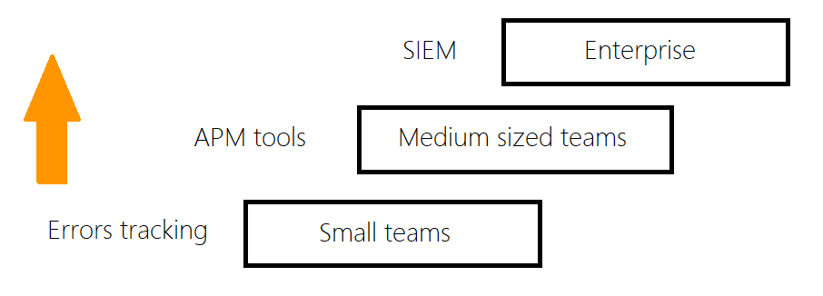

After five years working in the minitoring industry I learned a lot about the impact monitoring platforms has in the Cyber Security posture of software development companies. In today's interconnected world, the need for robust cybersecurity measures has become more critical than ever before. One essential component of a comprehensive cybersecurity strategy is Security Information and Event Management (SIEM) systems.

In this tutorial, we will delve into the realm of SIEM, exploring its definition, purpose, and the role it plays in the software system monitoring.

Whether you're a seasoned software developer or new to the field, this guide will equip you with a comprehensive understanding of SIEM and its importance in the cybersecurity landscape.

## What is SIEM?

SIEM, an acronym for Security Information and Event Management, is a platform that combines security information management (SIM) and security event management (SEM) capabilities. It provides organizations with a centralized platform to collect, analyze, and correlate security-related data from various sources within the IT infrastructure.

## Core Components of SIEM

A typical SIEM solution consists of four primary components:

- **Data collection agents**: These software packages that collect security event logs and other relevant data from various sources such as firewalls, intrusion detection systems, servers, and endpoints.
- **Log management**: It involves the storage, indexing, and retention of collected security logs for compliance and investigation purposes.
- **Event correlation and analysis**: This component processes and correlates collected data to identify patterns, detect anomalies, and uncover potential security incidents.
- **Incident response and reporting**: SIEM systems generate alerts, notifications, and reports to facilitate incident response and provide insights for remediation.

## Real-Time Threat Detection and Incident Response

SIEM monitors network and system events in real-time, enabling the detection of security incidents as they occur. By correlating diverse event logs and applying advanced analytics, SIEM solutions can identify suspicious activities, potential breaches, and unauthorized access attempts. This can potentially allows security teams to respond swiftly and effectively to mitigate the impact of cyber threats.

Data collected by agents enables security teams to perform historical analysis, track user activity, investigate incidents, and identify trends or patterns that may indicate ongoing threats.

Compliance and Regulatory Requirements: SIEM solutions assist organizations in meeting regulatory compliance requirements by providing mechanisms for collecting, storing, and analyzing security logs. Compliance standards such as the Payment Card Industry Data Security Standard (PCI DSS) and the General Data Protection Regulation (GDPR) often mandate the use of SIEM for log management and security monitoring.

## How SIEM Works

### Data Collection and Normalization

SIEM solutions employ data collection agents or connectors to gather log data from diverse sources across the IT infrastructure.

Once collected, the SIEM system normalizes the data, transforming it into a consistent format for efficient processing and analysis. Normalization ensures that log entries from various sources follow a standardized format, allowing for accurate correlation and identification of security events.

### Correlation and Analysis

In this stage, the SIEM system applies correlation rules, algorithms, and machine learning techniques to analyze the collected data. Correlation involves matching events from multiple sources and identifying patterns, anomalies, and potential security incidents from a common external/internal entity. The analysis may include rule-based detection, statistical analysis, and behavior profiling.

### Alerting and Incident Response

When a potential security incident is detected, SIEM must be able to generates alerts and notifications for security analysts or system administrators. These alerts provide essential details about the incident, enabling prompt investigation and response. I

ncident response workflows are often integrated within SIEM systems, allowing for streamlined processes, automated actions, and orchestration of connected tools.

## Challenges and Considerations

Implementing a SIEM comes with certain challenges and considerations: scalability, log source integration, rule development, managing false positives and negatives.

To ensure successful SIEM implementation, teams should define objectives, establish a log collection strategy, perform regular monitoring and maintenance, and invest in training and skill development for the security team.

## Role of SIEM in a Software Monitoring Strategy

While SIEM, error tracking tools, and application performance monitoring (APM) tools all play important roles in monitoring software systems, they have distinct focuses and functionalities.

Monitoring tools focus on performance and error tracking, SIEM focus its purpose on indentifying security risks.

Several SIEM solutions are available in the market, including Splunk Enterprise Security, IBM QRadar, LogRhythm, ArcSight, and AlienVault USM. Each solution has its own unique features, strengths, and pricing models.

Let's see what the main differences are between SIEM, Error Tracking Tool, and APM Tool.

### SIEM (Security Information and Event Management)

- **Focus**: Security monitoring, threat detection, and incident response.
- **Functionality**: Collects and analyzes security events and logs from various sources, correlates events to identify potential security threats, generates real-time alerts, and supports compliance monitoring and incident investigation.

### Error Tracking Tool

- Focus: Identifying and tracking software errors or exceptions.
- Functionality: Monitors applications for runtime errors, exceptions, and crashes. Captures error details, stack traces, and contextual information to help developers identify and fix bugs. Provides insights into the frequency, impact, and patterns of errors.

### APM Tool (Application Performance Monitoring)

- Focus: Monitoring application performance and user experience.
- Functionality: Collects and analyzes performance-related data, including response times, latency, throughput, CPU/memory usage, and database queries. Helps identify performance bottlenecks, optimize resource utilization, and improve user experience. May also provide transaction tracing and code-level visibility.

These tools cover different aspects of a software monitoring strategy and enables organizations to address security, stability, and performance aspects effectively. Based on the comapany stage of growth you can see one or more of them in place.

Error tracking tools is the first level due to its restricrted focus. From startup to medium sized teams APMs satisfies the need to monitor applications and must provide an effective alarm system. For big enterprise or regulated environments SIEM is a mandatory security layer.

