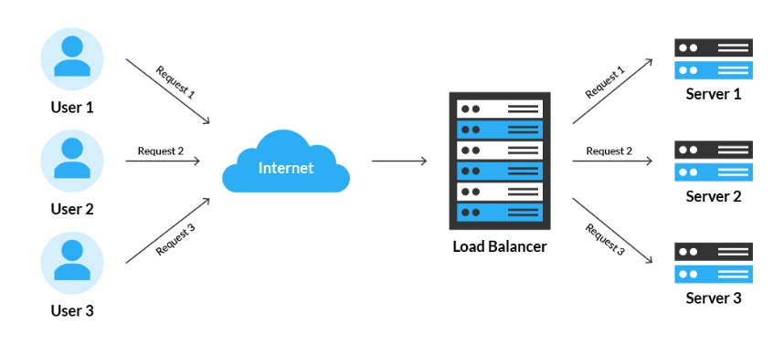
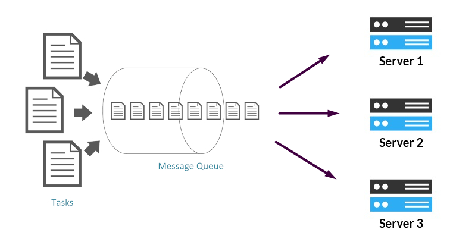

A nightmare (or a dream 🙂 ) for any software developer is an unexpected high influx of traffic or a sudden change in usage patterns that cause an application crash due to lack of computing resources.

Autoscaling is a critical service for any successful application to provide maximum performance and stability at all times.

Hi, I’m Valerio, software engineer, CTO at Inspector.

As CTO of a Code Execution Monitoring platform, I worked extensively with Autoscaling in order to support the growing demand of data analysis by our customers.

I know the size of the problem when new customers are coming in but your application is not ready to deliver its promise.

I decided to write down some concepts about Autoscaling based on my experience building Inspector, to help other developers or product owners to approach this architecture and unlock new business opportunities.

This article will answer:

- What is Autoscaling?
- What are the benefits of Autoscaling?
- What are the types of Autoscaling?
- How to prepare your application to use Autoscaling?
- How to monitor resource consumption?
- AWS Autoscaling and how we use it?

## What is Autoscaling

Autoscaling in a nutshell is a configurable policy offered by cloud providers to dynamically create or delete servers on which your application runs in order to guarantee an amount of hardware resources proportional to the incoming workload.

Without Autoscaling, the application’s compute, memory or networking resources are bound to the original server’s configuration. Suppose you have an application server with 2 vCPU and 8GB of RAM.

If the traffic increases and your machine is no longer able to sustain the load you have to make an image of your current machine and use it to start a new server with more resources then the previous one.

Once the new server is ready you can point your endpoints to the new machine.

As you can imagine it is a completely manual process with high risks of making mistakes and creating downtime for customers.

Autoscaling instead automatically increases or decreases the application’s capacity as demand fluctuates. Totally automated.

## Benefits of Autoscaling

There are several benefits of autoscaling crucial for software development. The most important, and prominent, benefits are maximizing resources (minimize costs) and improving software performance.

### Save Time and Money with Autoscaling

Without autoscaling, more resources (such as memory and CPU) must be provided on an on-going basis in order to support traffic spikes. Simply put, you have to oversize your machines to have buffer resources in case the workload increases.

Autoscaling increases and decreases these resources automatically depending on current demand. This reduces the amount of deployed but unused hardware resources, reducing overall costs.

### Increase Reliability and Performance with Autoscaling

With autoscaling, a software application is much more reliable and resistant against faults.

There are many reasons an application can crash. Autoscaling greatly reduces the risk of an application crashing due to lack of computing resources. That is a huge improvement.

In any case, scaling the application can lead to other architectural problems that we will see in the following sections.

## Types of Autoscaling

We have two dimensions of Autoscaling based on its direction (vertical or horizontal) and policy (reactive, predictive, and scheduled).

### Vertical or Horizontal Autoscaling

Vertical autoscaling consist on a change in hardware resources of the same machine. You can apply an autoscaling policy to a machine that will be changed in size based on the workload.

Horizontal autoscaling instead adds new machines as a copy of the original instance. So it changes the size of a cluster in terms of number of instances to support the incoming workload.

Let me say that vertical autoscaling is rarely supported. I see it only on **Virtuozzo** Jelastic cloud platforms. Scaling the size of the currently used machine isn’t easy without generating a bit of downtime. So many cloud providers don’t support this direction.

Horizontal autoscaling is widely supported. But the horizontal replication of your servers needs your application to be designed to run distributed across multiple servers.

### Reactive Autoscaling Policy

Reactive autoscaling scales resources as demand increases. After a spike in traffic, resources remain heightened for a period of time to anticipate a possible second surge in demand.

### Predictive Autoscaling Policy

Predictive autoscaling adjusts an application’s resources in prediction of upcoming traffic and demand levels. These predictions are made with artificial intelligence and machine learning to analyze patterns.

### Scheduled Autoscaling Policy

Scheduled autoscaling is what it implies: resources are scaled to specified levels on a specified date and time. This is a more hands-on approach, as the user must schedule the adjustments. This is beneficial in preparation for an expected increase in resource demand.

## How to prepare your application to use Horizontal Autoscaling

There are two types of architectures by which an application can scale horizontally: Load Balanced, and Queue Workers.

### Load balanced architecture

Load balancing is the process of distributing network traffic across multiple servers. This ensures no single server bears too much demand. By spreading the work evenly, load balancing improves application responsiveness. It also increases availability.

Here is an example of a typical load balanced architecture:

Modern applications can manage the servers behind the load balancer with auto scaling policies. Servers will be added or deleted dynamically based on the amount of the incoming traffic.

### Scaling queue workers

Another typical scenario in modern systems may depend on a messages queue.

The number of workers that consume the queue can be managed by autoscaling policies to set the amount of computing resources accordingly with the amount of messages to be processed.

## How to monitor and optimize resource consumption?

If your application is designed to scale horizontally to support the incoming traffic, or the internal load, you know that costs can be very volatile and can suddenly increase. In this scenario one of the most important variables to save costs is the type of virtual machine to use.

How do you know which one guarantees you the lowest price for the same performance?

Take the solution on the article below:

[**https://inspector.dev/how-to-save-thousands-of-dollars-in-cloud-costs-with-code-execution-monitoring/**](/how-to-save-thousands-of-dollars-in-cloud-costs-with-code-execution-monitoring/)

## Autoscaling Services: AWS Auto Scale

The Inspector platform is built on top of AWS cloud services, so we use [**AWS autoscaling**](https://aws.amazon.com/autoscaling/) features to scale the internal services.

In particular we use both architectures:

- Load Balancer - we have an “ingestion” autoscaling group, to scale in and out the ingestion nodes capacity;
- Queue Workers - we have a “worker” autoscaling group, to scale in and out the data process pipeline.

Both with reactive autoscaling policy.

## Conclusion

Autoscaling is essential for business growth. By automatically adjusting and allocating resources based on traffic and demand levels, autoscaling ensures an application is running smoothly and cost effectively at all times.

Autoscaling saves the resources of not only the application, but of the developers by saving time and money through automation.
