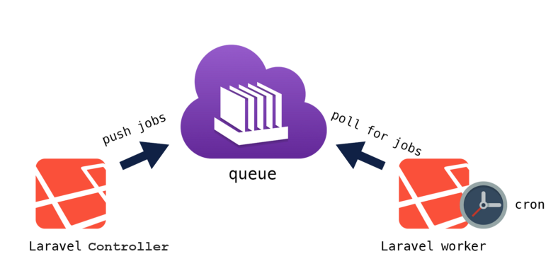
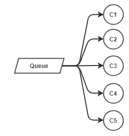
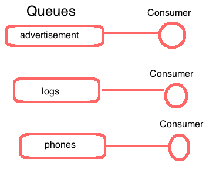
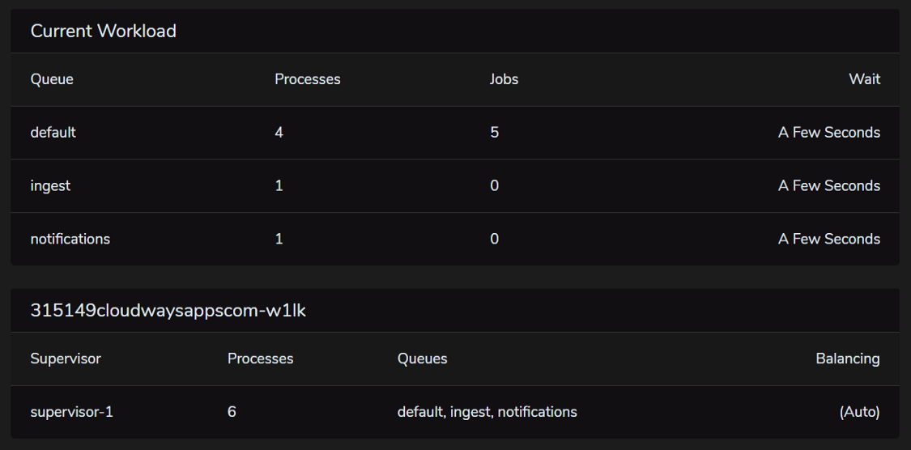

The Laravel queue and jobs system allows you to improve the scalability of your application backend. It's part of the magic of Laravel, because very few frameworks can actually boast such an advanced built-in solution for asynchronous jobs execution.

I first read about Laravel in late 2013 at the beginning of version 5.x. I wasn't involved in significant projects at that time. And one of the aspects of modern frameworks, especially Laravel, that sounded the most mysterious to me was "Queue and Jobs".

Reading the documentation, I guessed at the potential, but without real development experience, it remained a theory in my mind.

Today I'm the creator of [Inspector.](/) It's *a real-time monitoring dashboard* for Laravel applications. My product executes thousands of jobs every hour. So my knowledge of this architecture is much better today for sure.

In this article I'll show you what I learned about queue and jobs in Laravel. And also, what configurations helped me process a large amount of jobs in real-time while keeping server costs affordable.

## Lavarel queue and jobs: a gentle introduction

When a PHP application receives an incoming HTTP request it does two things. The code executes step by step until the request’s execution ends. And a response returns to the client (e.g., the user's browser).

That synchronous behavior is intuitive, predictable, and simple to understand. I launch an HTTP request to my endpoint. The application retrieves data from the database, converts it into an appropriate format, executes some more tasks, and sends it back. It’s linear.

Queues and jobs introduce asynchronous behaviors that break this linear flow. That's why I think it seemed a little strange to me initially.

But sometimes, a time-consuming task involves completing an execution cycle. Such as sending an email notification to all team members.

It could mean sending six or ten emails, taking four or five seconds to complete. So every time a user clicks on that button, they need to wait five seconds before they can continue using the app. The higher the number of users grows, the worse this problem gets.

## What do you mean with "time consuming tasks"?

It’s a legitimate question. Sending emails is the most common example used in articles about queues. But, I want to tell you what I needed to do in my experience.

As a product owner, I need to keep users' journey information in sync with our marketing and customer support tools. So, based on user actions, we update user information to various external software via APIs (a.k.a. external HTTP calls) for marketing and customer care purposes.

One of the busiest endpoints in my application could send ten emails and execute three HTTP calls to external services to finish. But, of course, no user would wait that long. So it's much more likely that they would stop using my application.

Thanks to queues:

1. I can encapsulate all these tasks in dedicated (executable) classes;
2. Pass in the contructor the information needed to do their job;
3. And schedule their execution for later in the background

This allow the controller to return a response immediately.

```php
class ProjectController 
{
    public function store(Request $request)
    {
        $project = Project::create($request->all());

        // Defer NotifyMembers, TagUserActive, NotifyToProveSource 
        // passing the information needed to do their job
        Notification::queue(new NotifyMembers($project->owners));

        $this->dispatch(new TagUserAsActive($project->owners));
        $this->dispatch(new NotifyToProveSource($project->owners));

        return $project;
    }
}
```

I don't need to wait until all these processes finish before returning a response. Instead, I'll wait only for the time required to publish them in the queue. This process could mean the difference between 10 seconds and ten milliseconds!

## Laravel queue: how it works!

This is a classic "publisher/consumer" architecture.

We've published the jobs in the queue from the controller, so now we will understand how to consume the queue, and finally execute the jobs.



To consume a queue we need to run one of the most popular artisan command:

```bash
php artisan queue:work
```

As reported in the [Laravel documentation](https://laravel.com/docs/master/queues#running-the-queue-worker):

> Laravel includes a queue worker that will process new jobs as they are pushed onto the queue.

Great!

Laravel provides a ready-to-use interface to put jobs in a queue and a ready-to-use command to pull jobs from the queue and execute them in the background.

## The role of Supervisor

This strategy was another "strange thing" to me at the beginning. Yet, that’s normal when discovering new things. Also, I have experienced this phase of learning. So, I write articles to help me organize my skills. And at the same time, I help other developers expand their knowledge

A supervisor is a process management system. In a nutshell: if a process crashes for any reason, Supervisor restarts it.

Why we should use a supervisor?

If a job fails wen firing an exception, the `queue:work` command will stop its work.

To keep the `queue:work` process running (consuming your queues), you should use a process monitor such as [Supervisor](https://laravel.com/docs/master/queues#supervisor-configuration). This ensure that the `queue:work` command will be automatically restarted in case it stops due to an exception.

The supervisor restarts the command after it goes down, starting again from the next job, abandoning the one that failed.

Jobs will be executed in the background on your server, no longer depending on an HTTP request. Yet, this introduces changes that you need to consider when implementing the job’s code.

Here are the most important in my mind:

## You don't have the request

*The HTTP request is gone*. Instead, your code executes from CLI.

If you need request parameters to accomplish your tasks, you need to pass them into the job's constructor to use later during execution:

```php
class TagUserJob
{
    public $data;

    public function __construct(array $data)
    {
        $this->data = $data;
    }
}

// Put the job in the queue from your controller
$this->dispatch(new TagUserJob($request->all()));
```

## You don't know who the logged user is

*The session is gone.* In the same way, you won't know the identity of the logged-in user. So, if you need the user information to do the task, you need to pass the user object to the job's constructor:

```php
class TagUserJob
{
    public $user;

    public function __construct(User $user)
    {
        $this->user= $user;
    }
}

// Put the job in the queue from your controller
$this->dispatch(new TagUserJob($request->user()));
```

## Laravel queue and jobs monitoring with Inspector

With jobs running in the background, you can’t see immediately if a job generates errors.

You will no longer have immediate feedback, such as the result of an HTTP request.

If the job fails, it will do it silently, without anyone noticing. Consider integrating a monitoring tool to check job execution in real-time and notify you if something goes wrong.  
That's what Inspector does.

It's a complete monitoring system for Laravel-based applications.

## How to scale the queue and jobs system

Unfortunately, often, it isn't enough. Using a single queue and consumer may soon become useless.

Queues are FIFO buffers (**F**irst **I**n, **F**irst **O**ut). If you schedule many jobs, and of different types, they need to wait for other jobs to execute their scheduled tasks before finishing theirs.

There are two ways to scale:

## Multiple workers for a queue



In this way, five jobs will pull from the queue together, speeding up the queue's consumption.

## Single-purpose queues

You could also create specific queues for each job "type" you launch. And you can use a dedicated consumer for each queue.



In this way, each queue is consumed without waiting for the execution of the other types of jobs.

## Laravel Jobs documentation

According to the [Laravel documentation](https://laravel.com/docs/6.x/queues#dispatching-jobs):

> Queue workers are long-lived processes and store the booted application state in memory. As a result, they will not notice changes in your codebase after they have been started. So, during your deployment process, be sure to [restart your queue workers](https://laravel.com/docs/6.x/queues#queue-workers-and-deployment).

Also, remember that you need to restart the queue workers again after any code changes or deployment.

## Lavarel Horizon

**[Laravel Horizon](https://laravel.com/docs/master/horizon)** is a queue manager that gives you complete control over how many queues you want to set up. It also provides the ability to organize consumers. And it allows you to combine these two strategies into one that fits your scalability needs

It starts with ***php artisan horizon*** command instead of ***php artisan queue:work***. This command scans your **horizon.php** configuration file and starts queue workers based on the configuration:

```php
'production' => [
    'supervisor-1' => [
        'connection' => "redis",
        'queue' => ['adveritisement', 'logs', 'phones'],
        'processes' => 9,
        'tries' => 3,
        'balance' => 'simple', // could be simple, auto, or null
    ]
]
```

As shown above, Laravel Horizon will start three queues with three processes assigned to consume each queue (9 in total).

As mentioned in [Laravel documentation](https://laravel.com/docs/master/horizon#introduction) Horizon's code-driven approach allows my configuration to stay in source control. It's where my team can collaborate. It's also a perfect solution when using CI/CD tools.

Learn the meaning of the configuration options in details, [by reading this article](https://medium.com/@zechdc/laravel-horizon-number-of-workers-and-job-execution-order-21b9dbec72d7).

### My Laravel Horizon configuration

```php
'production' => [
    'supervisor-1' => [
        'connection' => 'redis',
        'queue' => ['default', 'ingest', 'notifications'],
        'balance' => 'auto',
        'processes' => 15,
        'tries' => 3,
    ],
],
```

[Inspector](https://www.inspecotr.dev/) uses mainly three queues:

- **ingest** - for processes to analyze data from external applications;
- **notifications** - to schedule immediate notifications if an error is detected in a monitored application;
- **default** - for other tasks that I don’t want interfering with *ingest* and *notifications* processes.



Using **balance=auto**, Horizon knows that the largest number of processes to activate is 15. It distributes them according to the queues load.

If the queues are empty, Horizon keeps one process active for each queue. It also keeps a consumer ready to process the queue immediately if a job is scheduled.

As you have seen, concurrent background execution can cause unpredictable bugs. For example, MySQL "[**Lock wait timeout exceeded**](/resolved-mysql-lock-wait-timeout-exceeded-using-laravel-queues-and-jobs/)" and many other issues generated by an increasing in processes concurrency.

I hope this article has helped you gain more confidence in them.
