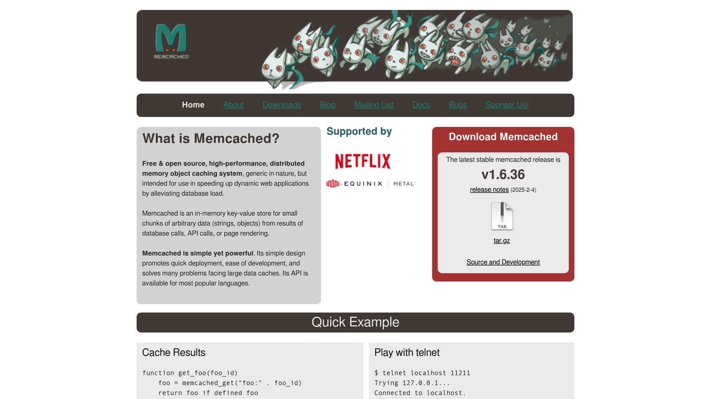

Caching in [Laravel](https://laravel.com/) improves performance by storing data for quick access. The location depends on the cache driver you use. Here's a quick guide:

- **File Cache**: Default option, stored in `storage/framework/cache/data`.
- **Database Cache**: Stores data in a database table. Requires setup.
- [**Redis**](https://redis.io/): Fast, in-memory storage for high-traffic apps.
- [**Memcached**](https://memcached.org/): Simple, fast, distributed key-value storage.

**Key Takeaway**: Use file caching for development, Redis or Memcached for production, and database caching for distributed systems.

### Quick Comparison

| Driver | Storage Location | Speed | Best Use Case |
| --- | --- | --- | --- |
| **File** | `storage/framework/cache/data` | Slow | Development, small apps |
| **Database** | Database table | Very Slow | Distributed apps |
| **Redis** | In-memory (RAM) | Very Fast | High-traffic, scalable systems |
| **Memcached** | In-memory (RAM) | Very Fast | Simple, fast, distributed caching |

Choose the right driver based on your app's needs for speed, scalability, and storage type. Continue reading for setup details and driver-specific features.

## [Laravel](https://laravel.com/) Cache Storage Locations

Choosing the right storage location is key to achieving the performance and scalability outcomes discussed earlier. Let's break down how Laravel handles cache storage and configuration.

### Cache Configuration Settings

Laravel's caching system starts with its configuration hierarchy. The main file to focus on is `config/cache.php`, which relies on environment variables to determine storage settings. The most important variable is `CACHE_DRIVER`, defined in your `.env` file:

```
CACHE_DRIVER=file
CACHE_PREFIX=myapp_cache_
```

These settings flow through `config/cache.php`, where driver-specific configurations are applied. Laravel uses the `env()` helper function to pull these values.

### File Cache Storage

The file cache driver is Laravel's default option. It stores cached data in the `storage/framework/cache/data` directory. Each cache item is saved as a separate encrypted file, with the filename based on the cache key. This method works well for development environments.

| File Cache Characteristics | Details |
| --- | --- |
| **Storage Location** | `storage/framework/cache/data` |
| **File Format** | Encrypted PHP serialized format |
| **Performance** | Moderate read, slow write |

### Database Cache Storage

Using the database cache driver involves storing cached data in a dedicated table within your application's database. Each cache entry includes:

- **key**: A unique identifier for the cached item.
- **value**: Serialized data for the cache entry.
- **expiration**: A timestamp indicating when the cache expires.

To set up database caching:

1. Run the cache table migration.
2. Update your `.env` file with the following:

```
CACHE_DRIVER=database
```

While not as fast as in-memory solutions, database caching can be a good fit when your app is distributed across multiple databases [<sup>\[3\]</sup>](https://loadforge.com/guides/mastering-laravel-cache-from-setup-to-advanced-optimization). This approach pairs well with memory-based systems, which we'll explore next.

## Memory-Based Cache Storage

Memory-based cache storage delivers faster performance than file or database caching by keeping data in RAM. Here’s a closer look at the two main memory-based cache options in Laravel: **Redis** and **Memcached**.

### [Redis](https://redis.io/) Storage System


Redis is an in-memory data store that handles advanced caching needs with its wide range of data structures and optional persistence features.

To set up Redis in Laravel, use the following configuration:

```php
// .env
CACHE_DRIVER=redis
REDIS_HOST=127.0.0.1
REDIS_PORT=6379
```

Redis stands out for its:

| Feature | Description |
| --- | --- |
| Data Structures | Supports various types |
| Persistence | Option to store data on disk |
| Operations | Executes commands atomically |

### [Memcached](https://memcached.org/) Storage System



Memcached is a distributed key-value store designed for speed. Its simplicity makes it ideal for basic caching tasks where performance is the priority.

To configure Memcached in Laravel, use this setup:

```php
// .env
CACHE_DRIVER=memcached
MEMCACHED_HOST=127.0.0.1
MEMCACHED_PORT=11211
```

Each system has its strengths. Redis is better suited for applications requiring advanced data structures or persistence, while Memcached is perfect for straightforward, high-speed caching with minimal complexity. Their performance differences will be covered in the upcoming speed comparison section.

## Cache Driver Speed Comparison

Let's dive into the performance differences among various cache drivers based on their storage methods:

| Driver | Speed | Persistence |
| --- | --- | --- |
| **Redis** | Very Fast | Configurable |
| **Memcached** | Very Fast | No |
| **File** | Slow | Yes |
| [**MySQL**](https://www.mysql.com/) | Very Slow | Yes |
| [**SQLite**](https://www.sqlite.org/) | Extremely Slow | Yes |

### Key Takeaways

- Drivers that store data in memory (like Redis and Memcached) are **2-10x faster** than those relying on disk storage. Memcached slightly outperforms Redis in write operations, but both are far superior to database-based caching, which slows down significantly as data grows.
- The choice between **RAM** and **disk** for storage plays a huge role in speed differences. This was evident in a case study where switching from file-based caching to Redis resulted in a **70% boost** in application responsiveness.

These findings highlight why Redis is often the go-to recommendation for production environments in Laravel, as discussed in the framework basics section.

## Summary

When deciding on the best cache driver for your application, it all comes down to your specific requirements. Here's a quick breakdown:

### Choosing the Right Cache Driver

Key factors to consider:

| Driver | Best Use | Speed |
| --- | --- | --- |
| **Redis** | High-traffic apps, distributed systems | Extremely fast |
| **Memcached** | Session storage, simple key-value data | Extremely fast |
| **File** | Development, small-scale applications | 5-10x slower than Redis |
| **Database** | Apps using existing database systems | Slower than in-memory options |

**Redis** is often the go-to choice for Laravel in production environments. It offers exceptional speed and supports more complex data structures [<sup>\[4\]</sup>](https://www.honeybadger.io/blog/caching-in-laravel/).

Keep in mind that storage type (RAM vs disk) plays a major role in performance. Memory-based options like Redis and Memcached consistently outperform disk-based solutions. Redis, in particular, shines in scenarios with heavy read operations.

## FAQs

Here are answers to some common questions about managing cache storage:

### Where is PHP cache stored?

In Laravel, the default file cache saves items as encrypted files in the `storage/framework/cache/data` directory. The filenames are based on the cache keys. If you're using other cache drivers, the data will be stored according to their specific methods.

### How do you find the storage path in Laravel?

Laravel provides the `storage_path()` helper to retrieve filesystem paths. Here's how you can use it:

```php
// Path to the cache directory
$cachePath = storage_path('framework/cache');

// Path to a specific file in storage
$filePath = storage_path('app/file.txt');
```

For drivers like Redis or Memcached, storage paths are determined by the server configurations set in `config/cache.php`.

## Related Blog Posts

- [Laravel Logging: Setup and Use](/log-channels-in-laravel-setup-and-use/)
- [Laravel Logging: Channels and Stacks Explained](/laravel-logging-channels-and-stacks-explained/)
- [Laravel Query Profiling: Tools and Techniques](/laravel-query-profiling-tools-and-techniques/)
- [Ultimate Guide to MySQL Query Caching in PHP](/ultimate-guide-to-mysql-query-caching-in-php/)
