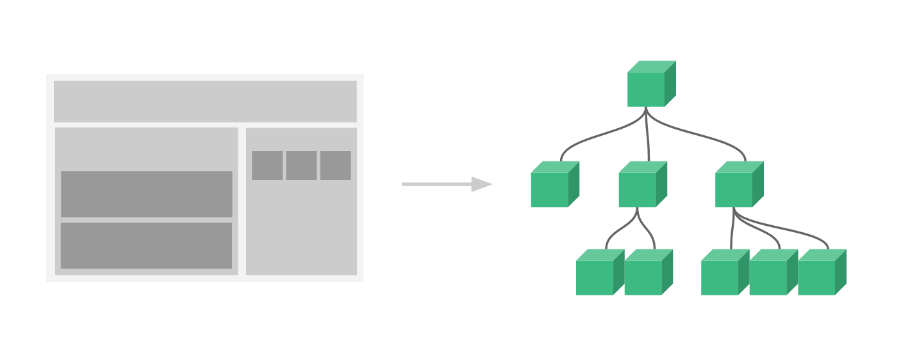

Have you ever used an event bus in Vue 2 and don't know how to recreate it in Vue 3?

Since I'm working on the 2.0 version of my product's UI (to be released in May) I'm publishing some technical tricks I learn migrating my application from Vuejs 2 to Vuejs 3.

The current version of the Inspector frontend application uses a global event bus to deal with some edge cases. It's needed to make the root component of the application (App.vue) aware of some particular events fired inside the components chain.

Before going into the details of this specfic implementation let me describe the principles of components communication in Vuejs and why we decided to use a global event bus even if this is a not recommended practice.

## Vuejs components communication

In Vuejs each component is responsible to render a piece of UI users are interacting with. Sometimes components are self-sufficient. They can retrieve data directly from the backend APIs. More often a component is a child of a more structured view that need to pass data to child components in order to render a specific part of the UI.



Components can expose props to their parents. Props are the data a component needs from a parent to make its work.

In the example below the component needs the user object to render its name with different styles based on its role.

```javascript title="User.vue"
<template>
    <span :class="{'text-danger': user.is_admin}">
        {{user.first_name}} {{user.last_name}}
    </span>
</template>

<script>
export default {
    props: {
        user: {
            type: Object,
            required: true
        }
    }
}
</script>
```

This strategy enforces reusability and promotes maintainability, and it is the best practice.

But, this works only for components with a direct relation in the tree, like a Menu.vue component that use the User.vue component to show the user name:

```javascript title="Menu.vue"
<template>
    <div class="menu">
        <a href="#" class="menu-item">
            Home
        </a>

        <a href="/user" class="menu-item">
            <User :user="user"/>
        </a>
    </div>
</template>

<script>
export default {
    data() {
        return {
            user: {}
        };
    },

    created() {
        axios.get('/api/user').then(res => this.user = res.data);
    }
}
</script>
```

**How can unrelated components communicate?**

## Vuejs global state

There are basically two ways of making unrelated components communicate with each other:

- Pinia (Vuex in the previous version)
- Event Bus

[Pinia](https://pinia.vuejs.org/) is a state management library. At first glance it seems complicated, and in fact it is a bit. You can use Pinia to store data that should be used globally in your app. Pinia provides you with a solid API to apply changes to this data and reflect them in all child components that use Pinia data store.

Event bus is related to the classic Events/Listeners architecture. You fire an event that will be treated by a listener function if there is one registered for that event.

98% of the stuff in your typical app is not a function, but really state. So you should use Pinia for everything as a default, and drop back to an Event Bus when Pinia becomes a hurdle.

## Event Bus use case (our scenario)

I have come across a scenario where I need to run a function not to manage a state. So Pinia (or Vuex) doesn't provide the right solution.

In Inspector the link to access the form for creating a new project is spread in several parts of the application. When the project is successfully created the application should immediately redirect to the installation instruction page. No matter where you are in the application, we must push the new route in the router to force navigation.

```javascript
(project) => {
    this.$router.push({
        name: 'projects.monitoring',
        params: {
            id: project.id
        }
    });
};
```

## How to create an event bus in Vue3

Vue 2 has an internal event bus by default. It exposes the **$emit()** and **$on()** methods to fire and listen for events.

So you could use an instance of Vue as event bus:

```javascript
export const bus = new Vue();
```

In Vue 3, Vue is not a constructor anymore, and Vue.createApp({}); returns an object that has no **$on** and **$emit** methods.

As suggested in official [docs](https://v3-migration.vuejs.org/breaking-changes/events-api.html#event-bus) you could use [mitt](https://github.com/developit/mitt) library to dispatch events across components.

First install mitt:

```bash
npm install --save mitt
```

Then I created a Vue plugin to make a **mitt** instance available inside the app:

```javascript title="src/Plugins/event-bus.js"
import mitt from 'mitt';


export default {
    install: (app, options) => {
        app.config.globalProperties.$eventBus = mitt();
    }
}
```

This plugin simply add **$eventBus** global property to the Vue instance so we can use it in every component calling **this.$eventBus**.

Use the plugin in your app instance:

```javascript
import { createApp } from 'vue';
const app = createApp({});

import eventBus from './Plugins/event-bus';
app.use(eventBus);
```

Now we can fire the event "project-created" from the project form to fire the function defined in the **App.vue** component:

```javascript
this.$eventBus.emit('project-created', project);
```

The global listener is placed in the root component ofthe app (App.vue).

```php
export default {
    created() {
        this.$eventBus.on('project-created', (project) => {
            this.$router.push({
                name: 'projects.monitoring',
                params: {
                    id: project.id
                }
            });
        });
    }
}
```

It will push the new route into the router redirecting the user to the application installation instructions.

You can follow me on [**Linkedin**](https://www.linkedin.com/in/valeriobarbera/) or **[X](https://x.com/Barbalerio)**. I post about building my SaaS business.
